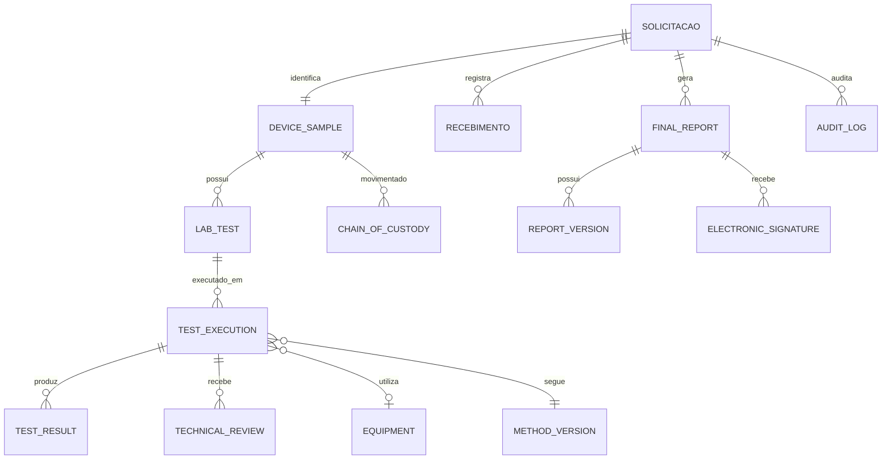

# Entrega 1 — Diagnóstico técnico-funcional do LIMS do SEFI

- **Projeto:** LIMS — Serviço de Ensaios Físicos (SEFI/FUNED)
- **Repositório:** `keyzermoura/LIMS`
- **Branch de referência:** `main`
- **Commit de referência:** `93743143b07e183ec38f8ad5f08c615a09cb801a`
- **Data da análise:** 09/11/2026
- **Tipo de atividade:** diagnóstico documental e inspeção de código, sem alteração da aplicação nesta entrega.

---

## 1. Objetivo

Registrar o diagnóstico técnico-funcional do LIMS existente, comparando sua estrutura e funcionalidades com o fluxo operacional definido para o Serviço de Ensaios Físicos (SEFI).

O objetivo é orientar a evolução do sistema aproveitando os componentes já implementados, evitando reconstruções desnecessárias e identificando, de forma rastreável, o que deve ser mantido, corrigido ou implementado.

## 2. Premissa operacional adotada

Para o fluxo de negócio do SEFI, fica estabelecida a seguinte premissa:

> Cada solicitação corresponde normalmente a um único dispositivo, que pode possuir um ou vários ensaios.

Consequentemente:

- Uma solicitação identifica a demanda e o solicitante.
- Cada solicitação está vinculada a um único dispositivo.
- O dispositivo pode possuir vários ensaios planejados.
- Cada ensaio planejado pode ter uma ou mais execuções independentes.
- Cada execução pode produzir um ou vários resultados e evidências.
- Os resultados passam por revisão técnica e pelas aprovações definidas no procedimento do laboratório.
- A solicitação origina o laudo consolidado, com controle de versão e assinaturas aplicáveis.

A identificação do dispositivo não deve ser confundida com a identificação única da solicitação. O mesmo produto, fabricante ou lote pode ser objeto de solicitações distintas.

## 3. Escopo e método da análise

Foram inspecionados, em modo de leitura, componentes do repositório relacionados a:

- modelos de domínio e relacionamentos;
- schemas e validações;
- serviços de aplicação;
- rotas da API;
- telas e tipos do frontend;
- migrações do banco de dados;
- testes automatizados;
- documentação e limitações declaradas no README;
- execução mais recente do pipeline de CI disponível na data da análise.

A classificação utilizada é:

- **Manter:** a funcionalidade existente atende à necessidade identificada e deve ser preservada.
- **Corrigir/Evoluir:** existe implementação aproveitável, mas são necessários ajustes de regra, estrutura ou fluxo.
- **Implementar:** não foi identificada estrutura suficiente para atender à necessidade.

A classificação é um diagnóstico inicial de aderência. Antes de cada alteração, os arquivos, relacionamentos, dependências e testes deverão ser novamente conferidos na branch de trabalho.

## 4. Arquitetura e tecnologias identificadas

A aplicação utiliza arquitetura cliente-servidor, com:

| Camada | Tecnologia identificada |
|---|---|
| Backend | Python e FastAPI |
| Persistência/ORM | SQLAlchemy 2 |
| Validação de dados | Pydantic |
| Banco de dados | PostgreSQL 16 |
| Migrações | Alembic |
| Frontend | React, TypeScript e Vite |
| Estilização | Tailwind CSS |
| Infraestrutura | Docker Compose e Nginx |
| Testes e qualidade | pytest, Ruff e mypy |

A estrutura do repositório separa API, modelos, schemas, serviços, migrações, testes e frontend. Essa organização oferece uma base adequada para evoluir o fluxo sem concentrar todas as regras nas telas.

## 5. Diagnóstico de aderência ao fluxo do SEFI

| Etapa/funcionalidade | Situação identificada | Classificação | Direcionamento |
|---|---|---|---|
| Cadastro da solicitação | O cadastro atual é centrado no registro de uma amostra/dispositivo e seu protocolo. Não foi identificada entidade independente de solicitação com o conjunto completo de dados da demanda. | Corrigir/Evoluir | Separar a demanda do cadastro físico do dispositivo, preservando a relação 1:1 definida para o SEFI. |
| Identificação do dispositivo | O modelo atual contempla dados como fabricante, nome comercial, modelo, lote, número de série, registro e localização. | Manter/Evoluir | Preservar os dados existentes e revisar obrigatoriedade e regras de unicidade. |
| Protocolo | O registro atual possui número de protocolo associado à amostra. | Corrigir/Evoluir | Definir o protocolo como identificador da solicitação, único e independente da identidade comercial/física do dispositivo. |
| Recebimento físico | Há registro de recebimento inicial e evento de custódia. | Corrigir/Evoluir | Formalizar o recebimento como etapa própria, com responsável, data/hora, conferência e condições de entrada. |
| Conferência e aceite | Não foi identificada etapa completa de conferência com decisão de aceite, aceite com ressalva ou recusa. | Implementar | Criar registro e fluxo de conferência, com justificativa e responsável. |
| Planejamento dos ensaios | O modelo de ensaio está vinculado ao dispositivo e permite vários ensaios para uma mesma amostra. | Manter/Evoluir | Preservar o relacionamento e distinguir planejamento de execução. |
| Distribuição aos analistas | Há associação de técnico/responsável aos ensaios. | Manter/Evoluir | Preservar a atribuição e avaliar fila, prazos, disponibilidade e reatribuição auditável. |
| Execução dos ensaios | O modelo atual registra ensaios e resultados, mas concentra aspectos do ensaio planejado e do resultado. | Corrigir/Evoluir | Criar entidade de execução independente, preservando o ensaio planejado e seus vínculos. |
| Repetição/interrupção | Existem versões/emendas de resultados assinados, mas isso não equivale a execuções independentes. | Corrigir/Evoluir | Registrar cada tentativa, interrupção, repetição, motivo e vínculo com a execução anterior, sem apagar o histórico. |
| Dados brutos e evidências | O README declara limitação quanto ao armazenamento de anexos e evidências. | Implementar | Planejar armazenamento controlado de planilhas, imagens, arquivos instrumentais e documentos, com integridade e vínculo aos registros. |
| Revisão técnica | Há recursos de assinatura e significados de assinatura associados a revisão/aprovação, mas não foi identificada uma entidade/etapa completa de revisão técnica com devolução e decisão. | Implementar | Formalizar revisão, revisor, data/hora, decisão, observações e histórico. |
| Aprovação da coordenação | Não foi identificada etapa própria para aprovação do conjunto de ensaios da solicitação. | Implementar | Criar etapa de coordenação com regras de conclusão e autorização para emissão. |
| Laudo consolidado | Há histórico/versionamento de resultados assinados por ensaio; não foi identificada estrutura equivalente para o laudo final consolidado da solicitação. | Implementar | Criar documento final por solicitação, com versões, conclusão, assinaturas e histórico. |
| Custódia e movimentação | Há estrutura de cadeia de custódia e registro de movimentações. | Manter | Preservar os eventos existentes e integrar recebimento, aceite, armazenamento e movimentações ao novo fluxo. |
| Auditoria e integridade | Há trilha de auditoria, encadeamento de hashes/HMAC e mecanismos de verificação. | Manter/Evoluir | Preservar os controles e estender os eventos às novas entidades e transições. |
| Assinatura eletrônica | Há reautenticação, token de intenção e vínculo da assinatura ao usuário/registro. | Manter/Evoluir | Reutilizar o mecanismo, definindo os pontos de assinatura e os documentos/decisões que exigem assinatura. |
| CAPA | Há estrutura de CAPA e abertura associada a reprovações. | Manter/Evoluir | Preservar e avaliar integração com desvios de recebimento, execução, revisão e laudo. |
| Equipamentos | Não foi identificada estrutura completa de cadastro e situação metrológica vinculada às execuções. | Implementar | Cadastrar equipamentos, identificação, situação, calibração/verificação e histórico aplicável. |
| Métodos de ensaio | Não foi identificada estrutura suficiente de versionamento de métodos vinculada a cada execução. | Implementar | Manter catálogo e versões de métodos/procedimentos, vinculando a versão efetivamente utilizada. |
| Condições ambientais | Não foi identificada estrutura específica suficiente para registrar condições ambientais por execução, quando aplicável. | Implementar | Prever registros ambientais com unidade, data/hora, responsável e critério aplicável. |
| Perfis e permissões | Há autenticação e controle de acesso por perfil/rota. | Manter/Evoluir | Revisar matriz de responsabilidades do SEFI e segregação entre execução, revisão e aprovação. |

## 6. Componentes existentes que devem ser aproveitados

### 6.1 Identificação e cadastro

O modelo `DeviceSample` já contempla informações relevantes do dispositivo e o número de protocolo (`accession_number`). Também há geração/validação de QR Code.

Referência: `backend/app/models/device_sample.py`.

### 6.2 Ensaios e resultados

O modelo `LabTest` está relacionado ao dispositivo por `device_sample_id`, permitindo vários ensaios para um mesmo dispositivo. Há estrutura de resultados e histórico de versões.

Referência: `backend/app/models/lab_test.py` e serviços/schemas associados.

### 6.3 Segurança, assinatura e auditoria

O sistema já contém controles que devem ser preservados e testados durante a evolução:

- autenticação e autorização por perfil;
- reautenticação para assinatura eletrônica;
- token de intenção de assinatura;
- vínculo da assinatura ao usuário e ao registro;
- histórico/versionamento de resultados;
- trilha de auditoria com mecanismos de integridade;
- registro de cadeia de custódia;
- estrutura de CAPA.

Esses recursos são uma base técnica importante, mas não representam, isoladamente, validação formal ou conformidade regulatória do sistema.

## 7. Pontos de atenção no modelo atual

### 7.1 Separação entre solicitação e dispositivo

O cadastro atual concentra informações do protocolo e do dispositivo no registro de amostra. Recomenda-se introduzir uma entidade própria de solicitação e manter uma relação 1:1 com o dispositivo.

A mudança deverá preservar os identificadores existentes e prever migração dos registros já cadastrados.

### 7.2 Obrigatoriedade do número de série

O schema atual exige informações de lote e número de série. Na rotina laboratorial, pode haver dispositivo sem número de série individual ou cuja identificação seja baseada em lote, modelo e outras características.

Recomenda-se avaliar a obrigatoriedade conforme o tipo de dispositivo, tornando o número de série opcional quando tecnicamente aplicável, sem perder a identificação inequívoca do material recebido.

### 7.3 Unicidade de fabricante, lote e número de série

Foi identificada restrição de unicidade associada à combinação de fabricante, lote e número de série. Essa regra pode impedir o registro de solicitações distintas referentes ao mesmo produto/lote.

Recomenda-se revisar a restrição: a unicidade do protocolo deve ser garantida na solicitação, enquanto a identificação do dispositivo deve admitir novas demandas legítimas, com regras adequadas para evitar duplicidade indevida.

### 7.4 Estados operacionais e resultados técnicos

Os estados da solicitação, do recebimento, do ensaio, da execução, da revisão e do laudo devem ser independentes.

Uma reprovação técnica em um ensaio não deve, por si só, ser confundida com cancelamento ou encerramento administrativo da solicitação. A conclusão do laudo deve seguir os critérios técnicos aplicáveis e as regras de aprovação do SEFI.

### 7.5 Execução independente

A entidade de execução deve registrar cada realização efetiva do ensaio. Repetições, interrupções e correções devem gerar histórico próprio, com justificativa e vínculo à tentativa anterior. Não se deve utilizar uma emenda de resultado como substituta desse histórico de execução.

## 8. Modelo conceitual recomendado

A estrutura conceitual proposta é:

### 8.1 Entidades e finalidade

| Entidade conceitual | Ação proposta | Finalidade |
|---|---|---|
| `solicitations` | Nova | Registrar demanda, solicitante, origem, datas, prioridade e situação. |
| `device_samples` | Evoluir | Identificar o dispositivo vinculado à solicitação. |
| `receipts` | Nova | Registrar recebimento físico, conferência, aceite, ressalvas ou recusa. |
| `lab_tests` | Reaproveitar/evoluir | Representar cada ensaio planejado para o dispositivo. |
| `test_executions` | Nova | Registrar cada execução independente do ensaio. |
| `test_results` | Evoluir | Registrar resultados, unidades, dados brutos, cálculos e conclusões. |
| `technical_reviews` | Nova | Registrar revisão, devolução, decisão, responsável e data/hora. |
| `equipment` | Nova/evoluir | Identificar equipamento e situação metrológica. |
| `method_versions` | Nova | Controlar método/procedimento e sua versão efetivamente utilizada. |
| `final_reports` | Nova | Controlar o laudo consolidado da solicitação. |
| `report_versions` | Nova | Preservar versões emitidas ou substituídas do laudo. |
| `electronic_signatures` | Reaproveitar/evoluir | Vincular assinaturas às decisões e documentos aplicáveis. |
| `chain_of_custody` | Manter/evoluir | Preservar movimentações e responsabilidades pela custódia. |
| `audit_logs` | Manter/evoluir | Registrar alterações e transições das novas entidades. |

Os nomes são conceituais e não determinam nomes definitivos de tabelas. A implementação deverá respeitar as convenções já existentes no projeto.

### 8.2 Regras estruturais

1. Uma solicitação deve estar vinculada a exatamente um dispositivo.
2. Uma solicitação pode possuir vários ensaios planejados.
3. Um ensaio planejado pode possuir várias execuções.
4. Cada execução deve identificar executor, datas, método/versão e equipamentos aplicáveis.
5. Uma execução pode gerar vários resultados e evidências.
6. Uma revisão não deve sobrescrever o resultado original.
7. Repetições devem ser registradas como novas execuções, com justificativa e vínculo histórico.
8. O laudo final deve ser consolidado a partir dos ensaios e resultados liberados.
9. Um laudo emitido não deve ser alterado silenciosamente; correções devem gerar nova versão ou documento substitutivo, mantendo o histórico.
10. Transições de estado e assinaturas devem gerar registros de auditoria.

## 9. Fluxo operacional de referência

1. **Solicitação cadastrada:** identificação da demanda e do solicitante.
2. **Recebimento físico:** registro de chegada, data/hora, responsável e condições.
3. **Conferência e aceite:** conferência documental e física, com aceite, ressalva ou recusa justificada.
4. **Planejamento dos ensaios:** definição dos ensaios, métodos, critérios e sequência.
5. **Distribuição:** atribuição dos ensaios aos analistas.
6. **Execução:** registro de dados brutos, resultados, método, equipamento e ocorrências.
7. **Revisão técnica:** verificação dos registros, cálculos, critérios e evidências.
8. **Coordenação:** aprovação do conjunto de resultados e autorização para emissão.
9. **Emissão do laudo:** geração do documento controlado, com resultados, conclusão e assinaturas.
10. **Conclusão e arquivamento:** encerramento da solicitação e preservação dos registros.

A solicitação não deve avançar para emissão enquanto houver ensaios pendentes, interrompidos sem decisão ou sem revisão/aprovação exigida. Eventuais exceções devem depender de regra formal, justificativa e autorização rastreável.

## 10. Estabilidade técnica — CI

Na execução mais recente consultada, referente ao commit `93743143b07e183ec38f8ad5f08c615a09cb801a`, o workflow de CI foi concluído com sucesso.

| Verificação | Resultado observado |
|---|---|
| Ruff (lint) | Aprovado |
| mypy (tipagem) | Aprovado |
| Migrações Alembic | Aprovadas |
| Paridade entre metadata e migrações | Aprovada |
| Testes SQLite | Aprovados |
| Testes PostgreSQL 16 | Aprovados |
| Build das imagens Docker | Aprovado |
| Smoke test da API, SPA e trilha | Aprovado |

Execução: https://github.com/keyzermoura/LIMS/actions/runs/42628535453

Essa execução supera as falhas anteriormente observadas nos testes SQLite. A CI aprovada demonstra que os testes e verificações automatizadas executados passaram naquele commit. Não comprova, isoladamente, prontidão para produção institucional, validação formal do sistema ou adequação integral à rotina do SEFI.

## 11. Limitações e ressalvas

O README do projeto já registra limitações do MVP, incluindo:

- rate limiting mantido em memória por processo;
- ausência de MFA/SSO;
- ausência de armazenamento de anexos;
- ausência de notificações;
- ausência de testes E2E de navegador;
- ausência de validação formal/qualificação do sistema e de dossiê regulatório.

Esses pontos devem ser avaliados no planejamento de implantação. A aplicação de controles técnicos inspirados em normas e regulamentos não autoriza declarar conformidade ou validação sem avaliação documentada, qualificação e evidências apropriadas.

A adequação deve considerar os requisitos aplicáveis da ISO/IEC 17025, os procedimentos internos do SEFI e demais normas/regulamentos pertinentes ao contexto institucional.

## 12. Plano de evolução recomendado

| Ordem | Etapa | Entrega esperada |
|---|---|---|
| 1 | Solicitação e recebimento | Demanda, protocolo, identificação do dispositivo, conferência e aceite. |
| 2 | Planejamento dos ensaios | Ensaios previstos, métodos, critérios e distribuição. |
| 3 | Execução e resultados | Execuções independentes, resultados, evidências e repetição. |
| 4 | Revisão técnica | Revisão, devolução, correção e aprovação técnica. |
| 5 | Coordenação | Aprovação do conjunto de resultados e liberação do laudo. |
| 6 | Laudo final | Documento consolidado, assinatura e versionamento. |
| 7 | Recursos laboratoriais | Equipamentos, situação metrológica, métodos e condições ambientais. |
| 8 | Qualificação e implantação | Testes de aceitação, evidências, treinamento, procedimentos e avaliação para uso institucional. |

Cada etapa deverá seguir um ciclo controlado:

1. Inspecionar o código existente e identificar arquivos e dependências.
2. Definir comportamento esperado e critérios de aceitação.
3. Implementar a menor alteração coerente com o escopo.
4. Criar ou atualizar testes automatizados.
5. Executar regressão e verificar migrações.
6. Revisar o diff e registrar decisões antes de integrar.

## 13. Conclusão

O LIMS possui uma base técnica relevante e componentes que devem ser preservados, especialmente identificação do dispositivo, relacionamento com ensaios, resultados, custódia, assinaturas, auditoria e CAPA.

A principal lacuna não é a ausência total de funcionalidades laboratoriais, mas a falta de separação explícita entre solicitação, dispositivo, recebimento/aceite, planejamento, execução independente, revisão técnica, aprovação da coordenação e laudo consolidado.

A recomendação é evoluir incrementalmente o sistema, começando por **solicitação e recebimento**, sem reconstruir os componentes que já atendem ao processo.

### Resultado desta entrega

- [x] Diagnóstico documental e inspeção do código em modo de leitura.
- [x] Definição da premissa operacional: uma solicitação para um dispositivo, com vários ensaios.
- [x] Classificação inicial em manter, corrigir/evoluir e implementar.
- [x] Modelo conceitual recomendado.
- [x] Registro do estado da CI consultada.
- [x] Plano de evolução proposto.
- [ ] Aprovação do desenho detalhado de solicitação e recebimento.
- [ ] Implementação das próximas etapas.

**Observação:** esta entrega é documental. Não inclui alteração de código, banco de dados, migrações ou configuração da aplicação.
