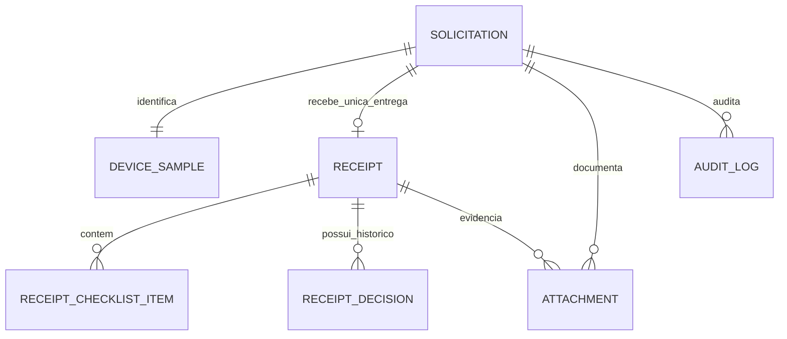

# Entrega 1 — Diagnóstico técnico-funcional do LIMS do SEFI

- **Projeto:** LIMS — Serviço de Ensaios Físicos (SEFI/FUNED)
- **Repositório:** `keyzermoura/LIMS`
- **Branch de referência:** `main`
- **Commit de referência:** `93743143b07e183ec38f8ad5f08c615a09cb801a`
- **Data da análise:** 09/11/2026
- **Tipo de atividade:** diagnóstico documental e inspeção de código, sem alteração da aplicação nesta entrega.

---

## 1. Objetivo

Registrar o diagnóstico técnico-funcional do LIMS existente, comparando sua estrutura e funcionalidades com o fluxo operacional definido para o Serviço de Ensaios Físicos (SEFI).

O objetivo é orientar a evolução do sistema aproveitando os componentes já implementados, evitando reconstruções desnecessárias e identificando, de forma rastreável, o que deve ser mantido, corrigido ou implementado.

## 2. Premissa operacional adotada

Para o fluxo de negócio do SEFI, fica estabelecida a seguinte premissa:

> Cada solicitação corresponde normalmente a um único dispositivo, que pode possuir um ou vários ensaios.

Consequentemente:

- Uma solicitação identifica a demanda e o solicitante.
- Cada solicitação está vinculada a um único dispositivo.
- O dispositivo pode possuir vários ensaios planejados.
- Cada ensaio planejado pode ter uma ou mais execuções independentes.
- Cada execução pode produzir um ou vários resultados e evidências.
- Os resultados passam por revisão técnica e pelas aprovações definidas no procedimento do laboratório.
- A solicitação origina o laudo consolidado, com controle de versão e assinaturas aplicáveis.

A identificação do dispositivo não deve ser confundida com a identificação única da solicitação. O mesmo produto, fabricante ou lote pode ser objeto de solicitações distintas.

## 3. Escopo e método da análise

Foram inspecionados, em modo de leitura, componentes do repositório relacionados a:

- modelos de domínio e relacionamentos;
- schemas e validações;
- serviços de aplicação;
- rotas da API;
- telas e tipos do frontend;
- migrações do banco de dados;
- testes automatizados;
- documentação e limitações declaradas no README;
- execução mais recente do pipeline de CI disponível na data da análise.

A classificação utilizada é:

- **Manter:** a funcionalidade existente atende à necessidade identificada e deve ser preservada.
- **Corrigir/Evoluir:** existe implementação aproveitável, mas são necessários ajustes de regra, estrutura ou fluxo.
- **Implementar:** não foi identificada estrutura suficiente para atender à necessidade.

A classificação é um diagnóstico inicial de aderência. Antes de cada alteração, os arquivos, relacionamentos, dependências e testes deverão ser novamente conferidos na branch de trabalho.

## 4. Arquitetura e tecnologias identificadas

A aplicação utiliza arquitetura cliente-servidor, com:

| Camada | Tecnologia identificada |
|---|---|
| Backend | Python e FastAPI |
| Persistência/ORM | SQLAlchemy 2 |
| Validação de dados | Pydantic |
| Banco de dados | PostgreSQL 16 |
| Migrações | Alembic |
| Frontend | React, TypeScript e Vite |
| Estilização | Tailwind CSS |
| Infraestrutura | Docker Compose e Nginx |
| Testes e qualidade | pytest, Ruff e mypy |

A estrutura do repositório separa API, modelos, schemas, serviços, migrações, testes e frontend. Essa organização oferece uma base adequada para evoluir o fluxo sem concentrar todas as regras nas telas.

## 5. Diagnóstico de aderência ao fluxo do SEFI

| Etapa/funcionalidade | Situação identificada | Classificação | Direcionamento |
|---|---|---|---|
| Cadastro da solicitação | O cadastro atual é centrado no registro de uma amostra/dispositivo e seu protocolo. Não foi identificada entidade independente de solicitação com o conjunto completo de dados da demanda. | Corrigir/Evoluir | Separar a demanda do cadastro físico do dispositivo, preservando a relação 1:1 definida para o SEFI. |
| Identificação do dispositivo | O modelo atual contempla dados como fabricante, nome comercial, modelo, lote, número de série, registro e localização. | Manter/Evoluir | Preservar os dados existentes e revisar obrigatoriedade e regras de unicidade. |
| Protocolo | O registro atual possui número de protocolo associado à amostra. | Corrigir/Evoluir | Definir o protocolo como identificador da solicitação, único e independente da identidade comercial/física do dispositivo. |
| Recebimento físico | Há registro de recebimento inicial e evento de custódia. | Corrigir/Evoluir | Formalizar o recebimento como etapa própria, com responsável, data/hora, conferência e condições de entrada. |
| Conferência e aceite | Não foi identificada etapa completa de conferência com decisão de aceite, aceite com ressalva ou recusa. | Implementar | Criar registro e fluxo de conferência, com justificativa e responsável. |
| Planejamento dos ensaios | O modelo de ensaio está vinculado ao dispositivo e permite vários ensaios para uma mesma amostra. | Manter/Evoluir | Preservar o relacionamento e distinguir planejamento de execução. |
| Distribuição aos analistas | Há associação de técnico/responsável aos ensaios. | Manter/Evoluir | Preservar a atribuição e avaliar fila, prazos, disponibilidade e reatribuição auditável. |
| Execução dos ensaios | O modelo atual registra ensaios e resultados, mas concentra aspectos do ensaio planejado e do resultado. | Corrigir/Evoluir | Criar entidade de execução independente, preservando o ensaio planejado e seus vínculos. |
| Repetição/interrupção | Existem versões/emendas de resultados assinados, mas isso não equivale a execuções independentes. | Corrigir/Evoluir | Registrar cada tentativa, interrupção, repetição, motivo e vínculo com a execução anterior, sem apagar o histórico. |
| Dados brutos e evidências | O README declara limitação quanto ao armazenamento de anexos e evidências. | Implementar | Planejar armazenamento controlado de planilhas, imagens, arquivos instrumentais e documentos, com integridade e vínculo aos registros. |
| Revisão técnica | Há recursos de assinatura e significados de assinatura associados a revisão/aprovação, mas não foi identificada uma entidade/etapa completa de revisão técnica com devolução e decisão. | Implementar | Formalizar revisão, revisor, data/hora, decisão, observações e histórico. |
| Aprovação da coordenação | Não foi identificada etapa própria para aprovação do conjunto de ensaios da solicitação. | Implementar | Criar etapa de coordenação com regras de conclusão e autorização para emissão. |
| Laudo consolidado | Há histórico/versionamento de resultados assinados por ensaio; não foi identificada estrutura equivalente para o laudo final consolidado da solicitação. | Implementar | Criar documento final por solicitação, com versões, conclusão, assinaturas e histórico. |
| Custódia e movimentação | Há estrutura de cadeia de custódia e registro de movimentações. | Manter | Preservar os eventos existentes e integrar recebimento, aceite, armazenamento e movimentações ao novo fluxo. |
| Auditoria e integridade | Há trilha de auditoria, encadeamento de hashes/HMAC e mecanismos de verificação. | Manter/Evoluir | Preservar os controles e estender os eventos às novas entidades e transições. |
| Assinatura eletrônica | Há reautenticação, token de intenção e vínculo da assinatura ao usuário/registro. | Manter/Evoluir | Reutilizar o mecanismo, definindo os pontos de assinatura e os documentos/decisões que exigem assinatura. |
| CAPA | Há estrutura de CAPA e abertura associada a reprovações. | Manter/Evoluir | Preservar e avaliar integração com desvios de recebimento, execução, revisão e laudo. |
| Equipamentos | Não foi identificada estrutura completa de cadastro e situação metrológica vinculada às execuções. | Implementar | Cadastrar equipamentos, identificação, situação, calibração/verificação e histórico aplicável. |
| Métodos de ensaio | Não foi identificada estrutura suficiente de versionamento de métodos vinculada a cada execução. | Implementar | Manter catálogo e versões de métodos/procedimentos, vinculando a versão efetivamente utilizada. |
| Condições ambientais | Não foi identificada estrutura específica suficiente para registrar condições ambientais por execução, quando aplicável. | Implementar | Prever registros ambientais com unidade, data/hora, responsável e critério aplicável. |
| Perfis e permissões | Há autenticação e controle de acesso por perfil/rota. | Manter/Evoluir | Revisar matriz de responsabilidades do SEFI e segregação entre execução, revisão e aprovação. |

## 6. Componentes existentes que devem ser aproveitados

### 6.1 Identificação e cadastro

O modelo `DeviceSample` já contempla informações relevantes do dispositivo e o número de protocolo (`accession_number`). Também há geração/validação de QR Code.

Referência: `backend/app/models/device_sample.py`.

### 6.2 Ensaios e resultados

O modelo `LabTest` está relacionado ao dispositivo por `device_sample_id`, permitindo vários ensaios para um mesmo dispositivo. Há estrutura de resultados e histórico de versões.

Referência: `backend/app/models/lab_test.py` e serviços/schemas associados.

### 6.3 Segurança, assinatura e auditoria

O sistema já contém controles que devem ser preservados e testados durante a evolução:

- autenticação e autorização por perfil;
- reautenticação para assinatura eletrônica;
- token de intenção de assinatura;
- vínculo da assinatura ao usuário e ao registro;
- histórico/versionamento de resultados;
- trilha de auditoria com mecanismos de integridade;
- registro de cadeia de custódia;
- estrutura de CAPA.

Esses recursos são uma base técnica importante, mas não representam, isoladamente, validação formal ou conformidade regulatória do sistema.

## 7. Pontos de atenção no modelo atual

### 7.1 Separação entre solicitação e dispositivo

O cadastro atual concentra informações do protocolo e do dispositivo no registro de amostra. Recomenda-se introduzir uma entidade própria de solicitação e manter uma relação 1:1 com o dispositivo.

A mudança deverá preservar os identificadores existentes e prever migração dos registros já cadastrados.

### 7.2 Obrigatoriedade do número de série

O schema atual exige informações de lote e número de série. Na rotina laboratorial, pode haver dispositivo sem número de série individual ou cuja identificação seja baseada em lote, modelo e outras características.

Recomenda-se avaliar a obrigatoriedade conforme o tipo de dispositivo, tornando o número de série opcional quando tecnicamente aplicável, sem perder a identificação inequívoca do material recebido.

### 7.3 Unicidade de fabricante, lote e número de série

Foi identificada restrição de unicidade associada à combinação de fabricante, lote e número de série. Essa regra pode impedir o registro de solicitações distintas referentes ao mesmo produto/lote.

Recomenda-se revisar a restrição: a unicidade do protocolo deve ser garantida na solicitação, enquanto a identificação do dispositivo deve admitir novas demandas legítimas, com regras adequadas para evitar duplicidade indevida.

### 7.4 Estados operacionais e resultados técnicos

Os estados da solicitação, do recebimento, do ensaio, da execução, da revisão e do laudo devem ser independentes.

Uma reprovação técnica em um ensaio não deve, por si só, ser confundida com cancelamento ou encerramento administrativo da solicitação. A conclusão do laudo deve seguir os critérios técnicos aplicáveis e as regras de aprovação do SEFI.

### 7.5 Execução independente

A entidade de execução deve registrar cada realização efetiva do ensaio. Repetições, interrupções e correções devem gerar histórico próprio, com justificativa e vínculo à tentativa anterior. Não se deve utilizar uma emenda de resultado como substituta desse histórico de execução.

## 8. Modelo conceitual recomendado

A estrutura conceitual proposta é:

### 8.1 Entidades e finalidade

| Entidade conceitual | Ação proposta | Finalidade |
|---|---|---|
| `solicitations` | Nova | Registrar demanda, solicitante, origem, datas, prioridade e situação. |
| `device_samples` | Evoluir | Identificar o dispositivo vinculado à solicitação. |
| `receipts` | Nova | Registrar a única entrega física da solicitação, conferência, aceite, ressalvas ou recusa. |
| `lab_tests` | Reaproveitar/evoluir | Representar cada ensaio planejado para o dispositivo. |
| `test_executions` | Nova | Registrar cada execução independente do ensaio. |
| `test_results` | Evoluir | Registrar resultados, unidades, dados brutos, cálculos e conclusões. |
| `technical_reviews` | Nova | Registrar revisão, devolução, decisão, responsável e data/hora. |
| `equipment` | Nova/evoluir | Identificar equipamento e situação metrológica. |
| `method_versions` | Nova | Controlar método/procedimento e sua versão efetivamente utilizada. |
| `final_reports` | Nova | Controlar o laudo consolidado da solicitação. |
| `report_versions` | Nova | Preservar versões emitidas ou substituídas do laudo. |
| `electronic_signatures` | Reaproveitar/evoluir | Vincular assinaturas às decisões e documentos aplicáveis. |
| `chain_of_custody` | Manter/evoluir | Preservar movimentações e responsabilidades pela custódia. |
| `audit_logs` | Manter/evoluir | Registrar alterações e transições das novas entidades. |

Os nomes são conceituais e não determinam nomes definitivos de tabelas. A implementação deverá respeitar as convenções já existentes no projeto.

### 8.2 Regras estruturais

1. Uma solicitação deve estar vinculada a exatamente um dispositivo.
2. Uma solicitação pode possuir vários ensaios planejados.
3. Um ensaio planejado pode possuir várias execuções.
4. Cada execução deve identificar executor, datas, método/versão e equipamentos aplicáveis.
5. Uma execução pode gerar vários resultados e evidências.
6. Uma revisão não deve sobrescrever o resultado original.
7. Repetições devem ser registradas como novas execuções, com justificativa e vínculo histórico.
8. O laudo final deve ser consolidado a partir dos ensaios e resultados liberados.
9. Um laudo emitido não deve ser alterado silenciosamente; correções devem gerar nova versão ou documento substitutivo, mantendo o histórico.
10. Transições de estado e assinaturas devem gerar registros de auditoria.

## 9. Fluxo operacional de referência

1. **Solicitação cadastrada:** identificação da demanda e do solicitante.
2. **Recebimento físico:** registro de chegada, data/hora, responsável e condições.
3. **Conferência e aceite:** conferência documental e física, com aceite, ressalva ou recusa justificada.
4. **Planejamento dos ensaios:** definição dos ensaios, métodos, critérios e sequência.
5. **Distribuição:** atribuição dos ensaios aos analistas.
6. **Execução:** registro de dados brutos, resultados, método, equipamento e ocorrências.
7. **Revisão técnica:** verificação dos registros, cálculos, critérios e evidências.
8. **Coordenação:** aprovação do conjunto de resultados e autorização para emissão.
9. **Emissão do laudo:** geração do documento controlado, com resultados, conclusão e assinaturas.
10. **Conclusão e arquivamento:** encerramento da solicitação e preservação dos registros.

A solicitação não deve avançar para emissão enquanto houver ensaios pendentes, interrompidos sem decisão ou sem revisão/aprovação exigida. Eventuais exceções devem depender de regra formal, justificativa e autorização rastreável.

## 10. Estabilidade técnica — CI

Na execução mais recente consultada, referente ao commit `93743143b07e183ec38f8ad5f08c615a09cb801a`, o workflow de CI foi concluído com sucesso.

| Verificação | Resultado observado |
|---|---|
| Ruff (lint) | Aprovado |
| mypy (tipagem) | Aprovado |
| Migrações Alembic | Aprovadas |
| Paridade entre metadata e migrações | Aprovada |
| Testes SQLite | Aprovados |
| Testes PostgreSQL 16 | Aprovados |
| Build das imagens Docker | Aprovado |
| Smoke test da API, SPA e trilha | Aprovado |

Execução: https://github.com/keyzermoura/LIMS/actions/runs/42628535453

Essa execução supera as falhas anteriormente observadas nos testes SQLite. A CI aprovada demonstra que os testes e verificações automatizadas executados passaram naquele commit. Não comprova, isoladamente, prontidão para produção institucional, validação formal do sistema ou adequação integral à rotina do SEFI.

## 11. Limitações e ressalvas

O README do projeto já registra limitações do MVP, incluindo:

- rate limiting mantido em memória por processo;
- ausência de MFA/SSO;
- ausência de armazenamento de anexos;
- ausência de notificações;
- ausência de testes E2E de navegador;
- ausência de validação formal/qualificação do sistema e de dossiê regulatório.

Esses pontos devem ser avaliados no planejamento de implantação. A aplicação de controles técnicos inspirados em normas e regulamentos não autoriza declarar conformidade ou validação sem avaliação documentada, qualificação e evidências apropriadas.

A adequação deve considerar os requisitos aplicáveis da ISO/IEC 17025, os procedimentos internos do SEFI e demais normas/regulamentos pertinentes ao contexto institucional.

## 12. Plano de evolução recomendado

| Ordem | Etapa | Entrega esperada |
|---|---|---|
| 1 | Solicitação e recebimento | Demanda, protocolo, identificação do dispositivo, conferência e aceite. |
| 2 | Planejamento dos ensaios | Ensaios previstos, métodos, critérios e distribuição. |
| 3 | Execução e resultados | Execuções independentes, resultados, evidências e repetição. |
| 4 | Revisão técnica | Revisão, devolução, correção e aprovação técnica. |
| 5 | Coordenação | Aprovação do conjunto de resultados e liberação do laudo. |
| 6 | Laudo final | Documento consolidado, assinatura e versionamento. |
| 7 | Recursos laboratoriais | Equipamentos, situação metrológica, métodos e condições ambientais. |
| 8 | Qualificação e implantação | Testes de aceitação, evidências, treinamento, procedimentos e avaliação para uso institucional. |

Cada etapa deverá seguir um ciclo controlado:

1. Inspecionar o código existente e identificar arquivos e dependências.
2. Definir comportamento esperado e critérios de aceitação.
3. Implementar a menor alteração coerente com o escopo.
4. Criar ou atualizar testes automatizados.
5. Executar regressão e verificar migrações.
6. Revisar o diff e registrar decisões antes de integrar.

## 13. Conclusão

O LIMS possui uma base técnica relevante e componentes que devem ser preservados, especialmente identificação do dispositivo, relacionamento com ensaios, resultados, custódia, assinaturas, auditoria e CAPA.

A principal lacuna não é a ausência total de funcionalidades laboratoriais, mas a falta de separação explícita entre solicitação, dispositivo, recebimento/aceite, planejamento, execução independente, revisão técnica, aprovação da coordenação e laudo consolidado.

A recomendação é evoluir incrementalmente o sistema, começando por **solicitação e recebimento**, sem reconstruir os componentes que já atendem ao processo.

### Resultado desta entrega

- [x] Diagnóstico documental e inspeção do código em modo de leitura.
- [x] Definição da premissa operacional: uma solicitação para um dispositivo, com vários ensaios.
- [x] Classificação inicial em manter, corrigir/evoluir e implementar.
- [x] Modelo conceitual recomendado.
- [x] Registro do estado da CI consultada.
- [x] Plano de evolução proposto.
- [x] Aprovação das regras operacionais do desenho detalhado de solicitação e recebimento, conforme consolidação da Entrega 1 — adendo de 09/11/2026.
- [ ] Implementação das próximas etapas.

**Observação:** esta entrega é documental. Não inclui alteração de código, banco de dados, migrações ou configuração da aplicação.

---

## 14. Desenho detalhado consolidado — Etapa 1: solicitação e recebimento

**Adendo de consolidação:** 09/11/2026. Este capítulo registra as decisões operacionais fornecidas pelo SEFI e prevalece sobre qualquer formulação anterior deste documento que seja incompatível com elas. A aprovação aqui registrada é do desenho funcional; não autoriza, por si só, iniciar alterações no código ou no banco de dados.

### 14.1 Decisões operacionais confirmadas

| Tema | Decisão consolidada | Consequência para o sistema |
|---|---|---|
| Quem cadastra | Solicitante externo ou servidor do SEFI | O fluxo deve aceitar solicitações originadas por usuários externos e por usuários internos autorizados. |
| Entrega física | Uma única entrega por solicitação | Cada solicitação terá no máximo um recebimento físico. Não haverá recebimentos parciais/complementares associados à mesma solicitação. |
| Responsável pela decisão | O servidor que realiza a conferência | O conferente registra e formaliza a decisão. A coordenação valida quando a regra institucional ou a situação exigir. |
| Geração do protocolo SEFI | Após decisão favorável de recebimento | Não gerar protocolo SEFI no simples cadastro nem na chegada física. Gerar somente após decisão favorável e, quando exigida, validação da coordenação. |

### 14.2 Escopo funcional e fronteiras

A Etapa 1 compreende:
1. cadastro e submissão da solicitação;
2. identificação do único dispositivo vinculado;
3. registro da chegada física em uma única entrega;
4. conferência documental e física;
5. decisão de recebimento pelo servidor conferente;
6. validação da coordenação nos casos configurados como sujeitos a validação;
7. geração do protocolo SEFI após a decisão favorável;
8. disponibilização da solicitação aceita para a etapa seguinte de planejamento dos ensaios.

Não fazem parte desta etapa o planejamento detalhado dos ensaios, sua execução, revisão técnica dos resultados ou emissão do laudo. A Etapa 1 apenas deverá deixar a solicitação em estado compatível com o encaminhamento futuro.

### 14.3 Atores, autenticação e permissões

**Solicitante externo**
- Pode iniciar e cadastrar uma solicitação pelo canal disponibilizado pelo LIMS.
- Informa seus dados de identificação e contato, a instituição de origem e os dados do dispositivo.
- Pode consultar as solicitações às quais está vinculado, conforme as permissões definidas.
- Não pode registrar recebimento, executar conferência, decidir aceite/recusa nem gerar protocolo SEFI.
- A consulta externa deve impedir acesso a solicitações de terceiros.

**Servidor do SEFI**
- Pode cadastrar solicitação em nome de uma unidade ou solicitante, identificando a origem e o responsável pela demanda.
- Pode registrar a chegada física e executar a conferência, desde que possua a permissão correspondente.
- O servidor que realiza a conferência formaliza a decisão de recebimento.
- Não deve conseguir validar em nome da coordenação quando a validação for exigida e a sua permissão não contemplar essa atribuição.

**Coordenação**
- Pode consultar solicitações e registros de recebimento.
- Realiza validação adicional quando exigida pelas regras institucionais ou encaminhada pelo conferente.
- A validação deve ser uma ação identificada, com usuário, data/hora, decisão e observação.
- Não deve apagar ou substituir a decisão originalmente registrada pelo conferente.

**Administrador**
- Configura perfis, permissões e parâmetros controlados.
- Não deve alterar silenciosamente decisões operacionais já formalizadas.

A autenticação do solicitante externo, o mecanismo de recuperação de acesso e a política de verificação de identidade deverão ser definidos no desenho técnico de segurança. O cadastro externo não deve ser tratado como usuário interno nem receber permissões por herança.

### 14.4 Dados da solicitação

A entidade de solicitação deverá contemplar, no mínimo:

| Campo conceitual | Obrigatoriedade | Regra |
|---|---|---|
| Identificador interno | Obrigatório | UUID ou padrão interno equivalente, imutável. |
| Número da solicitação | Obrigatório | Número legível, único e gerado pelo sistema. |
| Data/hora de criação | Obrigatório | Gerada pelo servidor, armazenada com fuso/UTC de forma consistente. |
| Origem do cadastro | Obrigatório | Externo ou servidor SEFI. |
| Solicitante responsável | Obrigatório | Usuário autenticado ou identificação institucional validada. |
| Instituição de origem | Obrigatório | Nome e, quando aplicável, identificador institucional. |
| Unidade/setor | Condicional | Quando informado ou aplicável. |
| Contato | Obrigatório | E-mail ou outro canal institucional válido para retorno. |
| Finalidade | Obrigatório | Motivo do encaminhamento ao laboratório. |
| Tipo de solicitação | Obrigatório | Valor de catálogo configurável. |
| Prioridade | Obrigatório | Valor de catálogo e justificativa quando prioritária, conforme regra institucional. |
| Observações | Opcional | Texto complementar. |
| Estado da solicitação | Obrigatório | Controlado por transições de estado, não por texto livre. |

O cadastro deve distinguir quem efetivamente preencheu/submeteu a solicitação de quem é o solicitante responsável, especialmente quando um servidor do SEFI registrar a demanda em nome de outra pessoa ou unidade.

### 14.5 Dados do dispositivo

Cada solicitação terá exatamente um dispositivo associado. Os campos existentes em `DeviceSample` devem ser reaproveitados sempre que compatíveis.

| Campo conceitual | Regra |
|---|---|
| Categoria/tipo de dispositivo | Obrigatório, preferencialmente catálogo controlado. |
| Fabricante | Obrigatório, conforme informação declarada/disponível. |
| Nome comercial | Recomendado. |
| Marca | Opcional, quando distinta do fabricante. |
| Modelo/referência | Informar quando existente. |
| Lote | Obrigatório quando aplicável ao tipo de dispositivo. |
| Número de série | Opcional quando o produto não possuir série individual. |
| Registro/notificação ANVISA | Informar quando aplicável/disponível. |
| Quantidade declarada/encaminhada | Obrigatória, maior que zero. |
| Unidade de medida | Obrigatória, de catálogo controlado. |
| Identificação complementar | Opcional, para características necessárias à rastreabilidade. |

A quantidade declarada na solicitação deve ser preservada separadamente da quantidade efetivamente recebida. A regra de identificação não pode impedir solicitações distintas do mesmo fabricante, produto ou lote. O protocolo da solicitação, e não a combinação comercial fabricante/lote/série, é o identificador único do processo.

### 14.6 Registro único de recebimento físico

A cardinalidade aprovada é **uma solicitação para um dispositivo e, no máximo, um recebimento físico**. A chegada do dispositivo deve ser registrada uma única vez para aquela solicitação.

O registro de recebimento deve conter:
- identificador interno;
- solicitação vinculada, com restrição de unicidade que impeça segundo recebimento;
- data e hora efetivas da chegada;
- servidor que recebeu;
- servidor responsável pela conferência, que pode ser o mesmo recebedor;
- quantidade efetivamente recebida;
- forma de entrega, quando pertinente;
- condição da embalagem e do dispositivo;
- observações e divergências;
- referências às evidências/documentos, quando disponíveis.

Se a quantidade recebida divergir da declarada, o sistema deve registrar a divergência e exigir sua avaliação na conferência. Não deve criar um segundo recebimento para corrigir a quantidade. Correções de dados devem ser auditadas e não podem apagar o valor originalmente informado.

### 14.7 Conferência

A conferência será registrada por itens individualizados, com resultado:
- Conforme;
- Não conforme;
- Não aplicável.

Checklist inicial proposto:
1. identificação do dispositivo compatível com a solicitação;
2. fabricante identificado;
3. modelo/referência identificado, quando existente;
4. lote identificado, quando aplicável;
5. número de série conferido, quando existente;
6. quantidade recebida conferida;
7. embalagem em condição adequada;
8. documentação correspondente à solicitação;
9. ausência de dano aparente que inviabilize ou comprometa a avaliação;
10. observações e evidências de divergências.

O checklist deverá ser configurável e versionado, para que alterações futuras não modifiquem retrospectivamente o conteúdo de conferências já concluídas. Itens marcados como não conformes exigem observação. Itens não aplicáveis exigem justificativa quando assim definido pela configuração.

### 14.8 Decisão de recebimento e validação da coordenação

A decisão é formalizada pelo servidor que realizou a conferência. São permitidos três resultados:

- **Aceito:** requisitos de entrada atendidos.
- **Aceito com ressalvas:** entrada permitida, com ressalvas registradas e sem pendência impeditiva para a entrada no fluxo.
- **Recusado:** entrada não aprovada, com justificativa obrigatória.

A decisão deve registrar conferente, data/hora, resultado, justificativa/observações e referência à versão do checklist utilizada.

A validação da coordenação é condicional, não universal. O sistema deverá permitir identificar os casos em que ela é obrigatória por regra institucional ou por encaminhamento fundamentado do conferente. Quando exigida:
- a decisão do conferente fica registrada como pendente de validação;
- a coordenação registra aprovar ou devolver/rejeitar a decisão, com responsável, data/hora e justificativa;
- a decisão favorável somente produz os efeitos de aceite final após a validação;
- a coordenação não substitui nem apaga o registro original do conferente.

A matriz objetiva de situações que exigem validação da coordenação ainda deverá ser definida pelo SEFI antes da implementação. Até essa definição, não se deve codificar critérios arbitrários. A configuração inicial deve permitir encaminhamento explícito à coordenação, sem presumir que todo aceite exija validação.

### 14.9 Geração do protocolo SEFI

O número da solicitação é criado no cadastro. O protocolo SEFI é outro identificador e só poderá ser gerado quando:
1. o recebimento único estiver registrado;
2. a conferência estiver concluída;
3. a decisão for Aceito ou Aceito com ressalvas;
4. não houver pendência impeditiva;
5. a validação da coordenação estiver concluída favoravelmente, se exigida.

O protocolo deve ser único, imutável e não reutilizável. A geração deve ocorrer em operação transacional, evitando duplicidade em tentativas simultâneas ou repetição de requisições. A etiqueta/QR Code deverá usar o protocolo SEFI gerado, preservando o mecanismo de QR Code já existente quando tecnicamente compatível.

Solicitações recusadas, ainda não recebidas ou aguardando validação não recebem protocolo SEFI. Se houver correção posterior ou reversão excepcional de decisão, o sistema deverá registrar novo evento auditável; não deve apagar nem reutilizar identificadores.

### 14.10 Estados e transições da Etapa 1

Recomenda-se manter estados distintos para solicitação, recebimento e decisão.

**Solicitação**
- Em elaboração;
- Aguardando recebimento;
- Em conferência;
- Aguardando validação da coordenação;
- Recebida — apta ao planejamento;
- Recusada;
- Cancelada.

**Recebimento**
- Não registrado;
- Registrado;
- Em conferência;
- Conferência concluída.

**Decisão**
- Não formalizada;
- Aceito;
- Aceito com ressalvas;
- Recusado;
- Aguardando validação;
- Validado pela coordenação;
- Devolvido/rejeitado pela coordenação.

Transições principais:
1. criação da solicitação → Em elaboração;
2. submissão → Aguardando recebimento;
3. registro da chegada → Em conferência;
4. conclusão do checklist e decisão do conferente → decisão registrada;
5. se validação for exigida → Aguardando validação da coordenação;
6. validação favorável, ou decisão do conferente sem necessidade de validação → aceite final;
7. aceite final → geração do protocolo SEFI e estado Recebida — apta ao planejamento;
8. recusa → estado Recusada, sem protocolo SEFI;
9. cancelamento → permitido somente com justificativa e conforme permissões/regras institucionais.

A recusa de recebimento não deve ser confundida com reprovação de ensaio. A solicitação recusada permanece consultável e auditável.

### 14.11 Entidades e restrições de dados revisadas

| Entidade | Cardinalidade/regra consolidada |
|---|---|
| `solicitations` | Uma solicitação representa uma demanda e tem um único dispositivo. |
| `device_samples` | Relação 1:1 com solicitação; dados de identificação do dispositivo. |
| `receipts` | Relação 1:0..1 com solicitação; no máximo um recebimento físico. |
| `receipt_checklist_items` ou equivalente | Vários itens por recebimento, vinculados à versão do checklist. |
| `receipt_decisions` ou histórico equivalente | Histórico de decisões do conferente e validações da coordenação, sem sobrescrita. |
| `attachments` | Arquivos/documentos associados à solicitação, recebimento ou conferência, com controle de acesso e integridade. |
| `audit_logs` | Eventos de cadastro, submissão, recebimento, conferência, decisão, validação e geração do protocolo. |

A relação conceitual atualizada para o recebimento é:

A cardinalidade 1:0..1 significa que a solicitação pode ainda não ter chegado; depois do registro, não poderá haver segundo recebimento. A existência de vários registros históricos de decisão não representa várias entregas.

### 14.12 Critérios de aceite específicos da Etapa 1

A implementação será considerada funcionalmente aceita quando:
1. usuário externo autorizado e servidor do SEFI conseguirem cadastrar solicitação conforme suas permissões;
2. cadastro por servidor permitir identificar o solicitante/origem da demanda;
3. cada solicitação tiver exatamente um dispositivo associado;
4. cada solicitação aceitar no máximo um recebimento físico;
5. quantidade declarada e recebida forem registradas separadamente;
6. checklist registrar resultado por item, observação e versão;
7. somente o servidor responsável pela conferência (ou perfil autorizado em regra explícita) formalizar a decisão;
8. a validação da coordenação ocorrer somente nos casos configurados como obrigatórios;
9. aceite com ressalvas exigir descrição e não permitir pendência impeditiva para o avanço;
10. recusa exigir justificativa e não gerar protocolo SEFI;
11. protocolo SEFI ser gerado apenas após decisão favorável e validação da coordenação, quando exigida;
12. geração do protocolo ser única, transacional e idempotente;
13. alterações e decisões permanecerem auditáveis;
14. solicitante externo não acessar solicitações de terceiros nem executar funções internas;
15. testes automatizados cobrirem cadastro interno/externo, entrega única, duplicidade de recebimento, divergência de quantidade, aceite, ressalva, recusa, validação condicional, geração de protocolo e permissões.

### 14.13 Pendências de definição institucional antes do desenvolvimento

As decisões principais desta etapa estão consolidadas. Permanecem apenas definições de parametrização que não devem ser inventadas pela implementação:
- quais tipos de solicitação e prioridades serão disponibilizados;
- quais campos/documentos serão obrigatórios para cada tipo de dispositivo ou solicitação;
- política de autenticação e validação cadastral dos solicitantes externos;
- padrão de numeração e apresentação do protocolo SEFI.

Essas definições podem ser registradas em catálogo/configuração institucional, sem alterar a arquitetura central.

### 14.14 Situação da Etapa 1

- [x] Decisão sobre quem pode cadastrar: solicitante externo e servidor do SEFI.
- [x] Decisão sobre entrega: uma única entrega por solicitação.
- [x] Decisão sobre responsabilidade: conferente formaliza; coordenação valida quando necessário.
- [x] Decisão sobre protocolo: gerado após decisão favorável.
- [x] Consolidação do fluxo, dados, permissões, entidades, estados e critérios de aceite.
- [ ] Definição dos parâmetros institucionais pendentes.
- [ ] Aprovação final dos parâmetros e do desenho técnico.
- [ ] Implementação em branch de trabalho dedicada, sem alteração direta da branch principal.

## 15. Matriz de validação da coordenação e critérios impeditivos do recebimento

**Situação:** proposta aprovada pelo usuário em 09/11/2026 como regra inicial de negócio para a Etapa 1. Esta aprovação consolida o desenho funcional; não autoriza, por si só, alterações de código, banco de dados ou migrações.

### 15.1 Princípios de decisão

1. A validação da coordenação é condicional e deve ocorrer apenas nas situações previstas nesta matriz ou quando o conferente registrar encaminhamento fundamentado.
2. Divergências que comprometam a identificação inequívoca do dispositivo não podem ser dispensadas por autorização administrativa simples.
3. Risco não controlado à segurança, suspeita de contaminação ou condição que inviabilize a avaliação impede o aceite até avaliação e tratamento documentados.
4. O checklist deve distinguir não conformidade impeditiva, exceção sujeita à coordenação e ocorrência administrativa corrigível pelo conferente.
5. A decisão e a validação são eventos distintos: a coordenação não apaga nem substitui a avaliação original do conferente.
6. Aceite com ressalvas não significa liberação automática para planejamento ou ensaio quando ainda existir ação impeditiva pendente.

### 15.2 Matriz de situações que exigem validação da coordenação

| Situação identificada | Tratamento inicial | Validação da coordenação | Regra/limite |
|---|---|---|---|
| Quantidade recebida diferente da declarada | Registrar quantidade e divergência | Obrigatória | Avaliar impacto no escopo e decidir por aceite, ressalva ou recusa. |
| Quantidade recebida insuficiente para os ensaios planejados | Registrar insuficiência | Obrigatória | Definir se o escopo pode ser ajustado ou se a solicitação deve ser complementada/revista. |
| Embalagem danificada, sem evidência conclusiva de comprometimento do dispositivo | Registrar dano e evidências | Obrigatória | Não liberar automaticamente para ensaio; avaliar risco de integridade. |
| Lacre violado ou indício de abertura/manipulação | Registrar condição e evidências | Obrigatória | Avaliar rastreabilidade, integridade e possibilidade de aceitação com restrições. |
| Dano físico aparente no dispositivo, com impacto ainda incerto | Registrar localização, extensão e evidências | Obrigatória | A coordenação decide se a condição impede, limita ou não interfere na avaliação. |
| Documento complementar ausente, sem prejuízo à identificação inequívoca | Registrar pendência documental | Obrigatória | Definir se pode ser aceito com ressalva e prazo/condição para regularização. |
| Condição de transporte ou armazenamento potencialmente inadequada | Registrar informação disponível e requisito aplicável | Obrigatória | Avaliar se há evidência de comprometimento do dispositivo ou do resultado. |
| Pedido de prioridade excepcional ou fora dos critérios institucionais | Registrar justificativa do solicitante/conferente | Obrigatória | Aprovação não altera critérios técnicos nem precedência legal/institucional. |
| Outra exceção não prevista, encaminhada fundamentadamente pelo conferente | Registrar fato, risco e justificativa | Obrigatória quando encaminhada | A coordenação deve decidir expressamente e justificar. |

**Situações que não são passíveis de dispensa pela coordenação como simples exceção de recebimento:**

| Situação | Classificação | Consequência |
|---|---|---|
| Dispositivo recebido não corresponde ao solicitado | Impeditiva | Não aceitar como o dispositivo objeto daquela solicitação. Corrigir a solicitação ou registrar nova demanda, conforme regra institucional. |
| Fabricante não identificável ou divergente de modo que impeça identificar o produto solicitado | Impeditiva | Suspender a decisão até esclarecimento documental ou correção formal. |
| Lote divergente ou não identificável, quando sua identificação for aplicável e necessária à rastreabilidade | Impeditiva | Não liberar para planejamento/ensaio até regularização. |
| Número de série divergente, quando informado e aplicável à identificação individual | Impeditiva | Não aceitar até esclarecimento/correção formal. |
| Documentação legal/técnica definida como obrigatória para aquele tipo de solicitação ausente | Impeditiva | Manter pendente ou recusar; a coordenação não pode dispensar requisito institucional obrigatório. |
| Suspeita de contaminação, vazamento ou risco não controlado à saúde/segurança | Impeditiva | Isolar/segregar conforme procedimento de segurança e impedir aceite/liberação até tratamento formal. |

A coordenação pode orientar a correção, determinar avaliação adicional ou decidir pela recusa, mas não pode converter uma divergência de identidade ou um requisito obrigatório em conformidade sem evidência e regularização. Se a instituição admitir exceção normativa em algum caso específico, essa exceção deverá ser formalmente definida em procedimento próprio, com fundamento e controle, antes de ser parametrizada no sistema.

### 15.3 Critérios do checklist de recebimento

O checklist deve ser versionado e permitir marcar cada item como **Conforme**, **Não conforme** ou **Não aplicável**. Não aplicabilidade e não conformidade exigem justificativa conforme a configuração do item.

| Código | Critério verificado | Classe | Regra de resposta |
|---|---|---|---|
| C01 | O dispositivo recebido corresponde ao descrito na solicitação | Impeditivo | Não conforme bloqueia aceite. |
| C02 | Fabricante está identificado e é compatível com a solicitação | Impeditivo | Não conforme bloqueia aceite até esclarecimento. |
| C03 | Lote está identificado e é compatível, quando aplicável | Impeditivo | Não conforme bloqueia aceite até regularização. |
| C04 | Número de série está compatível, quando aplicável e informado | Impeditivo | Divergência bloqueia aceite até esclarecimento. |
| C05 | Quantidade recebida foi contada e registrada | Impeditivo para conclusão da conferência | Divergência deve ser registrada e encaminhada à coordenação; não pode ser ignorada. |
| C06 | Não há dano que comprometa identificação, segurança ou avaliação | Impeditivo quando o comprometimento for confirmado | Se o impacto for incerto, encaminhar à coordenação; se houver comprometimento confirmado, não aceitar para ensaio. |
| C07 | Não há risco não controlado de contaminação, vazamento ou segurança | Impeditivo | Não conforme bloqueia aceite e exige tratamento de segurança. |
| C08 | Documentação obrigatória para o caso está disponível | Impeditivo | Ausência bloqueia aceite até regularização. |
| C09 | Embalagem está íntegra e sem sinais relevantes de violação/manipulação | Exceção sujeita à coordenação | Não conforme exige evidência e decisão da coordenação. |
| C10 | Condições de transporte/armazenamento atendem aos requisitos aplicáveis | Exceção sujeita à coordenação | Não conforme exige avaliação da coordenação quando houver potencial impacto. |
| C11 | Documentos complementares requeridos estão disponíveis | Exceção sujeita à coordenação | Ausência pode admitir ressalva somente com decisão justificada. |
| C12 | Quantidade recebida é suficiente para o escopo de ensaios | Exceção sujeita à coordenação | Insuficiência exige decisão sobre ajuste do escopo ou outra providência. |
| C13 | Não há dano físico aparente com possível influência nos ensaios | Exceção sujeita à coordenação | Dano de impacto incerto exige avaliação documentada. |
| C14 | Condições para eventual aceite com ressalvas estão atendidas | Exceção sujeita à coordenação | Exige justificativa, ação requerida e validação da coordenação. |
| C15 | Prioridade excepcional está fundamentada e autorizada | Exceção sujeita à coordenação | Não altera requisitos técnicos de recebimento ou ensaio. |
| C16 | Dados cadastrais apresentam erro material de digitação sem impacto na identificação | Correção pelo conferente | Corrigir com registro de auditoria. |
| C17 | Dados de contato estão completos para comunicação | Correção administrativa | Solicitar complemento; não constitui por si só não conformidade do dispositivo. |
| C18 | Observações necessárias foram registradas | Administrativo | Exigir preenchimento quando houver ocorrência ou ressalva. |
| C19 | Identificação externa da embalagem foi registrada quando disponível | Administrativo | Ausência não bloqueia por si só, salvo regra específica aplicável. |
| C20 | Documento complementar posteriormente recebido foi anexado e relacionado | Administrativo | Registrar autoria, data/hora e vínculo; não apagar pendência/histórico anterior. |

A aplicabilidade de lote, série, documentação e condições de transporte deve ser parametrizada por tipo de dispositivo/solicitação. O sistema não deve exigir número de série para produtos que não possuam identificação serial individual.

### 15.4 Regras de bloqueio e encaminhamento

O motor de decisão deverá aplicar a seguinte ordem:

1. **Verificar completude:** impedir a conclusão se itens obrigatórios não tiverem resposta ou se faltarem dados essenciais da conferência.
2. **Verificar bloqueios impeditivos:** qualquer critério impeditivo não conforme mantém a solicitação sem aceite e sem protocolo SEFI. O registro deve indicar a pendência, a evidência e a providência necessária.
3. **Verificar exceções:** se houver ocorrência classificada como sujeita à coordenação, encaminhar a decisão para validação, mantendo o estado pendente.
4. **Formalizar decisão:** sem bloqueios e sem exceção pendente, o conferente poderá formalizar aceite ou recusa conforme as evidências.
5. **Concluir validação:** quando exigida, a coordenação registra aprovação ou devolução/rejeição, com justificativa. A devolução mantém o processo pendente para correção ou nova avaliação.
6. **Gerar protocolo:** somente após aceite final, sem bloqueio impeditivo e com validação favorável da coordenação quando aplicável.

O sistema deve impedir que uma resposta "Não conforme" em item impeditivo seja neutralizada por uma simples marcação de "aceito com ressalvas". A regularização deverá ser registrada como novo evento, mantendo o histórico do apontamento original.

### 15.5 Condições para aceite com ressalvas

O aceite com ressalvas somente poderá ocorrer quando todas as condições abaixo forem atendidas:

- a identidade do dispositivo estiver confirmada de forma inequívoca;
- não existir risco não controlado à saúde, à segurança ou à integridade do material;
- não houver requisito obrigatório de documentação pendente;
- a ocorrência não inviabilizar a avaliação nem comprometer de forma não controlada a validade dos resultados;
- a ressalva, as evidências e a justificativa estiverem registradas;
- a ação necessária, responsável e condição/prazo de regularização estiverem definidos, quando aplicável;
- a coordenação tiver validado a exceção.

Quando a ressalva exigir providência antes do planejamento ou da execução, o dispositivo poderá permanecer fisicamente recebido e segregado/pendente, mas não poderá avançar para ensaios até a baixa formal da pendência. O estado físico de recebimento não equivale à liberação técnica.

### 15.6 Responsabilidades e trilha de auditoria

- **Recebedor:** registra a chegada e os dados objetivos da entrega.
- **Conferente:** executa o checklist, registra evidências e formaliza a decisão inicial.
- **Coordenação:** avalia apenas exceções encaminhadas ou situações configuradas como obrigatórias; aprova ou devolve com justificativa.
- **Sistema:** aplica bloqueios, impede transições incompatíveis, preserva versões do checklist e registra eventos.

Cada resposta do checklist deve preservar: código e versão do critério, resultado, justificativa, responsável, data/hora e referência às evidências. Cada revisão da coordenação deve preservar decisão, justificativa, responsável, data/hora e vínculo à decisão do conferente. Correções não devem sobrescrever o registro original.

### 15.7 Estrutura lógica sugerida para parametrização

| Estrutura conceitual | Finalidade e atributos principais |
|---|---|
| `receipt_checklist_templates` | Identificação e versão do checklist; vigência; estado ativo/inativo. |
| `receipt_checklist_criteria` | Código, descrição, aplicabilidade, classe (impeditivo, coordenação, administrativo), obrigatoriedade de resposta/justificativa e ordem. |
| `receipt_checklist_responses` | Recebimento, critério e versão, resultado, justificativa, autor e data/hora. |
| `receipt_exceptions` | Ocorrência, classificação, evidências, risco/impacto, providência e estado. |
| `coordination_reviews` | Decisão do coordenador, justificativa, responsável, data/hora e vínculo à exceção/decisão do conferente. |

Os nomes são conceituais, não constituem definição final de tabelas ou autorização para migração. A implementação deverá avaliar compatibilidade com as entidades e convenções existentes no repositório.

### 15.8 Critérios de aceite funcionais complementares

A implementação deverá demonstrar, por testes automatizados, que:

1. divergência de dispositivo, fabricante, lote ou série aplicável bloqueia o aceite até regularização;
2. ausência de documento obrigatório bloqueia o aceite;
3. risco não controlado de segurança impede aceite e liberação;
4. divergência de quantidade encaminha à coordenação e não é descartada;
5. dano/violação de embalagem e dano físico de impacto incerto exigem avaliação da coordenação;
6. documento complementar ausente pode ser tratado como exceção somente com decisão justificada;
7. aceite com ressalvas exige identidade confirmada, ausência de bloqueios e validação da coordenação;
8. pendência que condicione planejamento/ensaio bloqueia a transição para essa etapa;
9. resposta não conforme impeditiva não pode ser contornada por aceite com ressalvas;
10. correções e reavaliações preservam os registros anteriores;
11. itens não aplicáveis respeitam as regras de aplicabilidade configuradas;
12. alterações futuras no checklist não modificam conferências já realizadas.

### 15.9 Pendências institucionais remanescentes

A matriz e os critérios iniciais estão aprovados como regra funcional. Antes da implementação, ainda devem ser confirmados:
- catálogo de tipos de solicitação, categorias de dispositivo e prioridades;
- documentos obrigatórios por tipo de dispositivo/solicitação;
- aplicabilidade de lote, série, transporte e armazenamento por categoria;
- procedimento de segregação e tratamento de material com risco ou dano;
- prazos e responsáveis institucionais para regularização de ressalvas;
- padrão de numeração e apresentação do protocolo SEFI;
- perfis institucionais autorizados a validar, devolver, recusar e cancelar.

Esses parâmetros devem ser configuráveis e formalizados, sem enfraquecer os bloqueios de identificação, documentação obrigatória e segurança definidos nesta matriz.

### 15.10 Situação após aprovação

- [x] Matriz de situações sujeitas à validação da coordenação aprovada.
- [x] Critérios impeditivos do checklist aprovados.
- [x] Regras de aceite com ressalvas e bloqueios consolidadas.
- [x] Requisitos funcionais complementares para testes definidos.
- [ ] Confirmar parâmetros institucionais remanescentes.
- [ ] Submeter o desenho técnico de banco de dados e API para aprovação.
- [ ] Após aprovação específica, implementar em branch dedicada, sem alteração direta da `main`.
