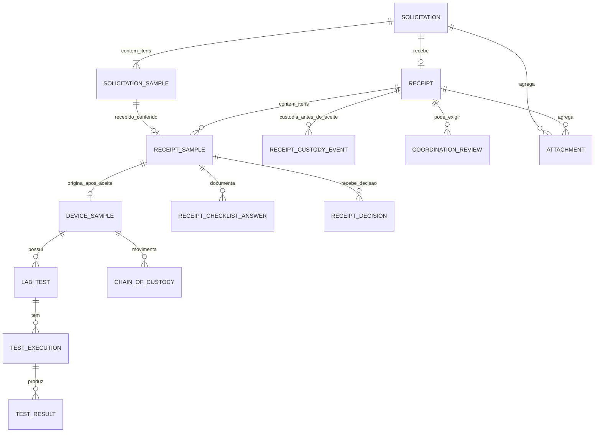

# LIMS — Desenho técnico proposto da Etapa 1: solicitação e recebimento

**Repositório:** `keyzermoura/LIMS`  
**Base de análise:** branch `main`, após o commit de documentação da matriz de recebimento de 09/11/2026.  
**Status:** proposta técnica para revisão e aprovação.  
**Escopo:** banco de dados, API, regras transacionais, permissões, integração com o fluxo existente e testes.  
**Fora do escopo desta entrega:** implementação, migrações, alteração de código ou implantação.

> Este documento é uma proposta de desenho. Os nomes de tabelas, campos e endpoints são sugestões técnicas a validar. Não constituem autorização para implementação.

## 1. Objetivo e premissas

Implementar futuramente a Etapa 1 do LIMS, inicialmente aplicada ao fluxo de recebimento do SEFI, com arquitetura institucional extensível aos demais laboratórios:

- uma solicitação representa uma demanda e pode conter um ou vários itens de amostra/dispositivo, cada qual cadastrado individualmente;
- uma solicitação admite no máximo um recebimento físico;
- quantidade declarada e quantidade recebida são informações distintas;
- o conferente registra a conferência e formaliza a decisão inicial;
- a coordenação valida apenas exceções previstas ou encaminhadas;
- bloqueios impeditivos não podem ser contornados por aceite com ressalvas;
- cada amostra aceita recebe um identificador institucional único, independente do laboratório; protocolos locais, inclusive eventual protocolo SEFI, são complementares;
- decisões, correções, checklist e validações devem permanecer auditáveis.

A proposta considera a arquitetura atualmente observada no repositório: FastAPI, SQLAlchemy 2, Pydantic, PostgreSQL 16, Alembic, autenticação/RBAC, auditoria e frontend React/TypeScript.

## 2. Diagnóstico técnico que condiciona a solução

### 2.1 Componentes existentes a reutilizar

| Componente atual | Uso proposto |
|---|---|
| `DeviceSample` / `device_samples` | Continuar como cadastro operacional do dispositivo recebido, ampliando sua relação com a solicitação. |
| `LabTest` / `lab_tests` | Continuar representando os ensaios planejados para o dispositivo. Não transformar cada execução em um novo `LabTest`. |
| `User` / `users` | Identificar operador interno, recebedor, conferente e coordenador. Solicitante/representante é dado cadastral na primeira entrega, sem conta externa. |
| Serviço de auditoria | Registrar eventos de solicitação, recebimento, conferência, decisão e validação. |
| Cadeia de custódia | Registrar a custódia inicial desde a chegada física no agregado `Receipt` (ou estrutura generalizada) e manter a continuidade após a criação de `DeviceSample`. |
| Assinatura eletrônica | Reavaliar sua aplicação a decisões formais segundo política institucional; não presumir que todo registro operacional exige assinatura eletrônica. |

### 2.2 Ajustes necessários

O modelo atual de `DeviceSample` contém campos de identificação e recebimento diretamente na amostra, incluindo número de série e lote não nulos e restrição única por série/lote/fabricante. Essa estrutura precisa ser revista com cuidado:

- número de série deve admitir ausência quando o dispositivo não possuir série individual;
- a identidade comercial não deve impedir solicitações diferentes do mesmo fabricante, lote ou produto;
- o número da solicitação identifica a demanda; cada amostra aceita recebe identificador institucional de controle, independente do laboratório; `accession_number` é o identificador técnico legado cuja equivalência deve ser avaliada para evitar duplicidade; protocolos locais são complementares;
- dados declarados da solicitação devem existir antes do recebimento físico, fora de `device_samples`;
- dados do recebimento, custódia prévia, conferência e decisão devem ser entidades próprias;
- não se deve apagar nem substituir o histórico de decisões.

A alteração da restrição de unicidade e da obrigatoriedade dos campos existentes exige análise de dados legados e migração reversível sempre que tecnicamente possível.

## 3. Modelo lógico proposto

### 3.1 Entidades novas e relações

| Entidade proposta | Finalidade | Relação principal |
|---|---|---|
| `solicitations` | Demanda cadastrada por usuário interno em nome do solicitante/representante | Uma solicitação pode conter vários itens de amostra |
| `receipts` | Registro da chegada física e conferência | Solicitação 1 : 0..1 recebimento |
| `receipt_custody_events` | Custódia física desde a chegada até a transferência/encerramento | Um ou vários eventos por recebimento |
| `receipt_checklist_templates` | Versões dos modelos de checklist | Um modelo possui critérios |
| `receipt_checklist_criteria` | Critérios configurados por versão | Um critério pode ser respondido em vários recebimentos |
| `receipt_checklist_responses` | Respostas imutáveis da conferência | Recebimento + critério + versão |
| `receipt_exceptions` | Exceções, bloqueios e providências | Vinculada ao recebimento/resposta |
| `coordination_reviews` | Decisões da coordenação | Vinculada à exceção e à decisão do conferente |
| `solicitation_status_history` | Histórico de transições, se não integralmente coberto pela auditoria atual | Solicitação |

A relação do novo fluxo será 1:N entre `Solicitation` e `SolicitationSample`; cada item declarado poderá originar no máximo uma `DeviceSample` após aceite individual. Os vínculos legados permanecerão opcionais e não serão preenchidos por inferência.

### 3.2 Campos conceituais

**`solicitations`**

| Campo | Tipo conceitual | Regra |
|---|---|---|
| id | UUID | Chave primária |
| request_number | string | Identificador da solicitação, único e gerado no cadastro |
| requester_user_id | Não aplicável na primeira entrega | Não criar vínculo com conta externa; preservar identificação e contato do solicitante/representante como dados cadastrais. |
| requester_name / requester_email | string | Identificação de contato preservada no momento do cadastro |
| submitted_by_user_id | UUID | Usuário que efetivamente cadastrou/submeteu |
| origin_unit | string | Unidade/organização solicitante |
| purpose | text | Finalidade do encaminhamento |
| request_type | FK/código | Catálogo institucional |
| priority | FK/código | Catálogo institucional |
| priority_justification | text, opcional | Obrigatória para prioridade excepcional |
| declared_quantity | decimal/integer | Maior que zero |
| unit_of_measure | FK/código | Catálogo controlado |
| status | enum/string controlada | Transições validadas no serviço |
| submitted_at | timestamptz, opcional | Data/hora de submissão |
| created_at / updated_at | timestamptz | Auditoria técnica |

Os campos de identificação do dispositivo podem permanecer em `device_samples`, desde que o vínculo 1:1 seja garantido e os dados sejam cadastráveis antes da chegada. A decisão entre manter o cadastro completo em `device_samples` ou criar uma entidade `solicitation_device` deve ser tomada após verificar os relacionamentos e dependências existentes.

**`receipts`**

| Campo | Tipo conceitual | Regra |
|---|---|---|
| id | UUID | Chave primária |
| solicitation_id | UUID | FK única; impede segundo recebimento |
| arrived_at | timestamptz | Data/hora efetiva da chegada |
| received_by_id | UUID | Usuário que recebeu fisicamente |
| checked_by_id | UUID | Conferente responsável |
| received_quantity | decimal/integer | Maior que zero |
| delivery_method | string/código | Quando aplicável |
| packaging_condition | string/código | Registro objetivo |
| device_condition | string/código | Registro objetivo |
| observations | text | Ocorrências relevantes |
| status | enum/string controlada | Estados de recebimento/conferência |
| created_at / updated_at | timestamptz | Auditoria técnica |

A unicidade de `solicitation_id` deve ser garantida no banco, não apenas na aplicação. Uma nova tentativa de POST não pode criar outro recebimento.

**`receipt_checklist_templates` e `receipt_checklist_criteria`**

- template: código, versão, nome, vigência, estado e autor da publicação;
- critério: template, código estável (C01–C20 na versão inicial), texto, classe, obrigatoriedade, regra de aplicabilidade, exigência de justificativa e ordem;
- publicação de nova versão não altera critérios já usados em conferências concluídas;
- critério publicado não deve ser editado retroativamente; correções geram nova versão.

**`receipt_checklist_responses`**

- recebimento;
- critério e versão;
- resultado: `CONFORME`, `NAO_CONFORME`, `NAO_APLICAVEL`;
- justificativa/observação;
- usuário responsável e data/hora;
- referência aos anexos/evidências;
- restrição única para impedir duas respostas correntes do mesmo critério no mesmo checklist, com estratégia de revisão/histórico definida no detalhamento físico.

**`receipt_exceptions`**

- recebimento e resposta relacionada;
- categoria: impeditiva, sujeita à coordenação ou administrativa;
- descrição factual, evidências, avaliação de risco/impacto;
- ação requerida, responsável e prazo, quando aplicável;
- estado: aberta, aguardando coordenação, devolvida, em regularização, resolvida ou encerrada;
- registro de resolução sem exclusão do apontamento inicial.

**`coordination_reviews`**

- exceção/decisão submetida;
- decisão: aprovada, devolvida para complementação ou rejeitada;
- justificativa obrigatória;
- coordenador responsável e data/hora;
- referência à versão da matriz/regra aplicada;
- histórico append-only: nova avaliação gera novo registro, sem sobrescrever anterior.

## 4. Restrições e integridade no PostgreSQL

Recomendações:

1. FKs entre `solicitation_samples` e `solicitations`, e entre `device_samples` e o item aceito, com unicidade por item para impedir duplicação; vínculos legados permanecem opcionais.
2. FK única de `receipts.solicitation_id` para impor no máximo um recebimento por solicitação.
3. `CHECK (declared_quantity > 0)` e `CHECK (received_quantity > 0)`, com tipo numérico adequado à unidade.
4. `CHECK`/enum para resultados de checklist, classes e estados, alinhado ao padrão atual de enums SQLAlchemy.
5. FKs para usuários com `ON DELETE RESTRICT`, preservando autoria.
6. Índices por número da solicitação, identificador institucional de controle, protocolo local quando aplicável, estado, solicitante, data e fila de validação.
7. Protocolo SEFI único e não nulo somente depois de gerado; considerar coluna inicialmente nula com índice único parcial no PostgreSQL.
8. Transições de estado e regra de bloqueio centralizadas no serviço de domínio; constraints no banco como segunda barreira.
9. Controle de concorrência otimista já utilizado no projeto, ou bloqueio transacional explícito, para impedir duas decisões concorrentes.
10. Não armazenar arquivo binário diretamente nas tabelas de negócio sem decisão arquitetural; metadados e integridade do anexo devem ser registrados, com armazenamento controlado.

A regra de “coordenação não pode dispensar bloqueio impeditivo” deve existir no serviço de domínio e ser coberta por testes; não deve depender apenas da interface web.

## 5. Fluxo transacional proposto

### 5.1 Cadastro e submissão

- criar solicitação em elaboração;
- identificar solicitante e autor do cadastro;
- cadastrar um ou mais itens de amostra/dispositivo, cada qual com seus dados declarados;
- validar campos obrigatórios conforme tipo;
- ao submeter, validar consistência e mudar para aguardando recebimento;
- registrar evento de auditoria.

### 5.2 Registro de recebimento

Uma transação deverá:

1. consultar a solicitação e verificar se está apta a receber;
2. bloquear concorrência sobre a solicitação ou usar controle otimista;
3. verificar ausência de recebimento anterior;
4. criar o recebimento com data/hora efetiva da chegada, recebedor físico, quantidade e condições observadas;
5. criar evento inicial de custódia vinculado ao recebimento, com responsável, data/hora, local e condição de guarda;
6. alterar estado para em conferência;
7. registrar evento de auditoria;
8. confirmar a transação.

A custódia começa na chegada física, antes da existência de `DeviceSample`. Os eventos iniciais devem pertencer ao agregado `Receipt` (por exemplo, `ReceiptCustodyEvent`) ou a uma estrutura de custódia generalizada que aceite origem `Receipt` e, após o aceite, `DeviceSample`. Não criar uma amostra antecipadamente apenas para registrar a guarda do material.

A restrição única no banco será a proteção final contra duplicidade, inclusive em requisições simultâneas.

### 5.3 Conferência e decisão

- carregar a versão ativa do checklist aplicável;
- gravar respostas e evidências;
- calcular bloqueios a partir da classificação versionada dos critérios;
- não permitir concluir se houver critério obrigatório sem resposta;
- se houver impeditivo não resolvido, manter pendência e impedir aceite;
- se houver exceção sujeita à coordenação, criar encaminhamento e deixar decisão aguardando validação;
- se não houver bloqueio nem exceção, permitir decisão do conferente;
- registrar decisão como evento não sobrescrevível.

### 5.4 Validação da coordenação

- verificar perfil/permissão e segregação de funções conforme política a aprovar;
- validar que a decisão encaminhada ainda corresponde à versão corrente do recebimento;
- verificar novamente todos os bloqueios impeditivos no servidor;
- permitir aprovar ou devolver/rejeitar com justificativa;
- gravar revisão e auditoria na mesma transação;
- uma aprovação não pode, por si só, alterar respostas não conformes impeditivas.

### 5.5 Aceite final, criação da amostra e geração dos identificadores

A conclusão do aceite deve ser uma operação de domínio transacional e idempotente. Pré-condições: checklist concluído, decisão final favorável, ausência de impeditivos abertos e validação da coordenação quando exigida.

Na mesma transação lógica, o serviço deverá:
- confirmar a decisão final e a versão do recebimento;
- criar exatamente uma `DeviceSample` para cada item individualmente aceito, com os dados verificados e confirmados;
- preencher `DeviceSample.received_at` com `Receipt.arrived_at`, a data/hora efetiva da chegada física, e `received_by_id` com o usuário que recebeu fisicamente o material;
- manter separada a data/hora de criação da amostra nos campos técnicos próprios, como `created_at`;
- gerar identificador institucional único para cada amostra criada, independentemente do laboratório; verificar se `accession_number` já cumpre essa função e pode ser preservado para manter o QR atual. Não criar dois identificadores internos equivalentes; protocolo local será complementar;
- vincular amostra, solicitação e recebimento e preservar, sem reescrita, o histórico de custódia iniciado na chegada;
- registrar assinatura, auditoria e chave de idempotência.

A unicidade no banco deve impedir mais de uma `DeviceSample` para o mesmo item e duplicidade do identificador institucional. Itens diferentes da mesma solicitação podem originar amostras diferentes. Reenvios retornam o resultado já criado. Se uma única transação de banco não for tecnicamente possível, adotar estado intermediário recuperável e reconciliação determinística, sem duplicação ou perda de rastreabilidade.

## 6. API REST proposta

Prefixo sugerido: `/api/v1`, mantendo o padrão de roteadores já existente.

| Método | Endpoint proposto | Ação | Permissão principal |
|---|---|---|---|
| POST | `/solicitations` | Criar solicitação assistida | Usuário interno autorizado |
| GET | `/solicitations` | Listar solicitações conforme atribuição | Perfil interno autorizado |
| GET | `/solicitations/{id}` | Consultar detalhes | Perfil interno autorizado |
| PATCH | `/solicitations/{id}` | Corrigir enquanto em elaboração/pendência autorizada | Usuário interno autorizado |
| POST | `/solicitations/{id}/submit` | Submeter solicitação | Usuário interno autorizado |
| POST | `/solicitations/{id}/receipt` | Registrar entrega física única | Recebedor/conferente autorizado |
| GET | `/receipts/{id}` | Consultar recebimento | Perfil interno autorizado |
| GET | `/receipts/{id}/checklist` | Obter checklist aplicável | Recebedor/conferente |
| PUT | `/receipts/{id}/checklist` | Registrar respostas e evidências | Conferente responsável |
| POST | `/receipts/{id}/decision` | Formalizar decisão do conferente | Conferente responsável |
| POST | `/receipts/{id}/coordination-review` | Aprovar/devolver/rejeitar | Coordenação autorizada |
| POST | `/receipt-samples/{id}/accept-and-register` | Concluir aceite do item, criar a amostra e gerar seu identificador institucional de forma idempotente | Serviço/perfil interno autorizado |
| GET | `/coordination/reviews` | Consultar fila de validação | Coordenação |
| GET | `/receipt-checklists/active` | Consultar checklist ativo | Perfis internos |

A API deve retornar erros de domínio claros, sem expor detalhes internos:

- `409 Conflict`: recebimento já existente, estado incompatível ou conflito de concorrência;
- `422 Unprocessable Entity`: campos inválidos, checklist incompleto ou regra impeditiva;
- `403 Forbidden`: usuário autenticado sem permissão;
- `404 Not Found`: registro inexistente ou não visível no escopo do usuário;
- `201 Created`: criação bem-sucedida;
- `200 OK`: consulta ou transição concluída.

A resposta de erro deve trazer código estável de domínio, mensagem objetiva e identificador de correlação. A implementação deve respeitar os esquemas Pydantic e o tratamento de erros já existente.

## 7. Segurança, perfis e segregação de funções

A primeira entrega é exclusivamente interna. O solicitante/representante não terá conta nem acesso direto à API; um servidor SEFI registra a solicitação em seu nome. A autorização deve ser aplicada no backend, não apenas ocultando botões no frontend.

| Ação | Servidor SEFI autorizado | Conferente | Coordenação |
|---|---:|---:|---:|---:|
| Criar solicitação própria ou em nome de terceiro | Sim | Conforme perfil | Conforme perfil |
| Consultar solicitações | Conforme atribuição | Conforme atribuição | Conforme atribuição |
| Registrar chegada física e custódia inicial | Conforme autorização | Sim | Conforme política |
| Preencher checklist e registrar dados verificados | Conforme designação | Sim | Consulta |
| Formalizar decisão inicial | Se designado conferente | Sim | Não substitui conferente |
| Validar exceção | Não, salvo perfil formalmente autorizado | Não | Sim |
| Concluir aceite, criar amostra e gerar protocolo | Serviço após pré-condições | Não diretamente | Não diretamente |

A tabela é uma matriz inicial de permissões, não uma afirmação de que os papéis atuais já correspondam a esses perfis. Será necessário mapear `UserRole` e as dependências RBAC existentes antes de definir novos papéis ou permissões granulares.

## 8. Organização provável do backend

Sugestão de organização, compatível com os diretórios existentes:

- `app/models/solicitation.py`
- `app/models/receipt.py`
- `app/models/receipt_checklist.py`
- `app/models/receipt_exception.py`
- `app/models/coordination_review.py`
- `app/schemas/solicitation.py`
- `app/schemas/receipt.py`
- `app/schemas/receipt_checklist.py`
- `app/api/v1/routes/solicitations.py`
- `app/api/v1/routes/receipts.py`
- `app/api/v1/routes/coordination.py`
- `app/services/solicitation_service.py`
- `app/services/receipt_service.py`
- `app/services/receipt_decision_service.py`
- `app/services/sample_identifier_service.py` (e serviço de protocolo específico do laboratório, se necessário)

Os serviços devem concentrar regras de negócio e transações. As rotas devem validar entrada, autenticar/autorizar e delegar ao serviço. Os modelos não devem conter regras complexas de transição.

## 9. Frontend proposto

Telas/fluxos mínimos para usuários internos:

1. **Nova solicitação assistida:** dados do solicitante/representante, dados declarados do dispositivo, finalidade, tipo e prioridade.
2. **Fila de solicitações:** status, número, data, solicitante/representante e pendências, conforme atribuição interna.
3. **Recebimento:** localizar solicitação, registrar chegada física, itens/quantidades entregues, recebedor, condição física e início da custódia.
4. **Conferência:** checklist versionado, dados verificados, divergências em relação ao declarado, observações, evidências e alertas de bloqueio.
5. **Decisão:** resumo automático dos impeditivos/exceções e formalização pelo conferente.
6. **Fila da coordenação:** exceções pendentes, evidências, decisão do conferente e ações disponíveis.
7. **Detalhe/rastreabilidade:** linha do tempo de submissão, chegada, custódia, checklist, decisão, validação, criação da amostra e protocolo.

Não haverá portal externo nem tela “Minhas solicitações” para usuários externos na primeira entrega.

A interface deve exibir claramente a diferença entre “recebido fisicamente”, “aceito” e “liberado para planejamento/ensaios”. O frontend não deve calcular sozinho se um bloqueio pode ser ignorado; deve apresentar a decisão do backend.

## 10. Estratégia de migração e compatibilidade

A migração deve ser incremental, evitando interromper o fluxo atual:

1. mapear registros atuais de `device_samples`, `lab_tests`, recebimento e QR;
2. identificar duplicidades e registros que seriam afetados pela atual restrição de identidade;
3. criar tabelas de solicitação/recebimento/checklist sem remover colunas antigas;
4. migrar dados históricos para a nova estrutura quando houver informação suficiente, marcando origem e incerteza;
5. manter campos legados durante período de compatibilidade;
6. adicionar relação 1:1 e validar integridade;
7. alterar nulabilidade e restrições de unicidade somente após plano de saneamento;
8. adaptar serviços/rotas e frontend;
9. executar testes de migração upgrade/downgrade em banco descartável;
10. retirar campos legados apenas em entrega posterior e autorizada.

Não se deve inventar solicitante, data de recebimento, conferente ou decisão para registros antigos quando essas informações não existirem. Dados históricos incompletos devem ser identificados como migrados/incompletos, não apresentados como se fossem registros contemporâneos completos.

## 11. Plano de testes da Etapa 1

### 11.1 Testes de modelo e migração
- cardinalidade 1:1 solicitação/dispositivo;
- no máximo um recebimento por solicitação;
- campos opcionais para lote/série conforme aplicabilidade;
- integridade de FKs e restrições;
- migração com banco vazio e com dados legados;
- upgrade/downgrade sem perda silenciosa.

### 11.2 Testes de serviço e regras
- cadastro externo e interno;
- cadastro em nome de terceiro;
- isolamento de dados entre solicitantes;
- submissão e correção por estado;
- entrega única inclusive em chamadas simultâneas;
- checklist completo/incompleto;
- cada bloqueio C01–C08;
- cada exceção C09–C15;
- correções administrativas C16–C20;
- não aplicabilidade justificada;
- bloqueio impeditivo não contornável;
- aceite, ressalva, recusa e devolução da coordenação;
- protocolo idempotente, único e transacional;
- auditoria de todas as transições.

### 11.3 Testes de API e interface
- códigos HTTP e mensagens de domínio;
- autorização por papel e por propriedade do registro;
- ausência de exposição de solicitações de terceiros;
- concorrência/duplo clique/reenvio;
- estados exibidos coerentes com backend;
- evidências anexadas e acessíveis apenas a perfis autorizados.

## 12. Sequência de implementação sugerida após aprovação

| Subetapa | Entrega | Critério para avançar |
|---|---|---|
| 1A | Modelagem final e migração aditiva | Revisão do esquema e estratégia de dados legados |
| 1B | Serviços e API de solicitação | Testes de cadastro, submissão, autorização |
| 1C | Recebimento e checklist versionado | Testes de entrega única e checklist |
| 1D | Decisão e validação da coordenação | Testes de bloqueios e exceções |
| 1E | Geração de protocolo SEFI | Testes de idempotência e transação |
| 1F | Frontend e integração ponta a ponta | Testes funcionais e aceite do usuário |
| 1G | Revisão de segurança, auditoria e documentação | Revisão final e aprovação antes de implantação |

Cada subetapa deve ser executada em branch de feature própria ou na branch de trabalho expressamente aprovada, com PR e CI. Não realizar commits diretamente em `main`.

## 13. Decisões ainda necessárias antes da implementação

1. O solicitante externo terá conta autenticada própria desde a primeira versão ou haverá cadastro assistido pelo servidor do SEFI?
2. Quais perfis internos existentes corresponderão a recebedor, conferente e coordenação? Será necessário criar permissões granulares?
3. A decisão do conferente e a validação da coordenação exigirão assinatura eletrônica formal ou autenticação com registro auditável será suficiente nesta etapa?
4. Qual padrão de numeração será usado para solicitação e identificador institucional de cada amostra? Protocolos locais de laboratório serão definidos separadamente, se necessários.
5. Quais documentos serão obrigatórios por categoria de dispositivo?
6. Como serão definidos os prazos e responsáveis por pendências/ressalvas?
7. Qual será a política de anexos: formatos, tamanho máximo, retenção, antivírus e armazenamento?
8. A solicitação poderá ser editada após submissão em quais situações e por quais perfis?
9. A instituição permitirá cancelamento após recebimento físico? Em que condições?
10. O protocolo SEFI será gerado automaticamente ao final do aceite ou por ação explícita do servidor?

## 14. Aprovação necessária

Solicita-se revisar este desenho técnico, especialmente:

- entidades e cardinalidades;
- estratégia de reaproveitamento de `DeviceSample`;
- endpoints e matriz de permissões;
- fluxo de decisão/coordenação;
- estratégia de migração dos registros existentes;
- decisões institucionais pendentes.

**Nenhuma alteração de código, banco, migração, endpoint ou interface foi realizada nesta entrega.** A implementação só deverá começar após aprovação explícita deste desenho e definição dos parâmetros institucionais necessários.

## 15. Recomendações técnicas consolidadas para decisão

Esta seção registra recomendações técnicas para orientar a revisão e reduzir ambiguidades antes da implementação. Elas **não representam, por si só, aprovação institucional definitiva** dos procedimentos nem autorização para alterar código, banco de dados, migrações, API ou interface.

### 15.1 Entidade de solicitação e reaproveitamento de DeviceSample

**Recomendação:** criar `Solicitation` como entidade própria, anterior ao recebimento, e manter `DeviceSample` como registro operacional do dispositivo que será efetivamente recebido e ensaiado.

- Uma solicitação representa uma demanda e pode conter um ou vários itens de amostra/dispositivo.
- Uma solicitação pode ter zero ou um recebimento formal.
- Cada item de amostra aceito origina uma amostra operacional (`DeviceSample`), que pode ser encaminhada a diferentes laboratórios e possuir vários ensaios planejados (`LabTest`).
- Cada ensaio planejado pode originar uma ou mais execuções independentes, mantendo resultados e evidências associados à execução correspondente.
- O protocolo SEFI identifica o ingresso formalmente aceito, não devendo ser atribuído antes da conclusão das condições de aceite.

Essa separação evita misturar intenção de encaminhamento, entrega física e registro laboratorial. Recomenda-se preservar os registros históricos de `DeviceSample` e estabelecer vínculo com a nova solicitação apenas quando houver correspondência confiável.

### 15.2 Acesso de solicitantes externos e cadastro assistido

**Recomendação:** prever desde o desenho a possibilidade de solicitante externo autenticado, sem impedir que um servidor do SEFI registre uma solicitação em nome de terceiro.

- Reaproveitar o mecanismo existente de autenticação, usuários e RBAC.
- Não criar um segundo cadastro independente de usuários ou uma estrutura paralela de papéis.
- Distinguir o usuário que efetivamente opera o sistema do solicitante/representante em nome de quem a solicitação é registrada.
- Aplicar autorização por perfil e por vínculo/propriedade do registro, impedindo que um solicitante externo consulte dados de terceiros.
- Registrar claramente autoria, representação e alterações realizadas por servidor interno.

A habilitação efetiva do acesso externo deverá depender de decisão institucional sobre identidade, validação cadastral, recuperação de acesso e suporte.

### 15.3 Segregação de funções

**Recomendação:** manter permissões granulares para recebimento, conferência, decisão, análise de exceção e validação da coordenação, reutilizando os papéis existentes sempre que possível.

Quando a política institucional exigir independência, o sistema deve impedir que o mesmo usuário aprove sua própria decisão ou exceção. A regra de segregação deve ser configurável por operação e aplicada no backend, não apenas ocultando botões na interface.

### 15.4 Migração incremental e preservação do legado

**Recomendação:** adotar migração aditiva e compatível, em etapas.

1. Criar as novas tabelas e relacionamentos sem remover estruturas existentes.
2. Preservar identificadores, resultados, assinaturas, histórico e trilhas de auditoria dos registros legados.
3. Migrar ou relacionar dados antigos somente quando a correspondência puder ser demonstrada com segurança.
4. Identificar explicitamente registros históricos incompletos ou sem informação suficiente; não preencher lacunas por inferência.
5. Manter compatibilidade temporária com os fluxos existentes, com testes de regressão.
6. Considerar eventual descontinuação de estruturas antigas apenas em etapa posterior, após validação, plano de reversão e aprovação.

A migração deverá ser testada com banco vazio, cópia representativa dos dados legados e cenários de falha/reexecução.

### 15.5 Identificador institucional de controle da amostra

**Recomendação:** gerar automaticamente, no backend, um número institucional único para cada amostra individualmente aceita e cadastrada no LIMS, sem incorporar a sigla ou identidade de um laboratório.

- Uma solicitação pode conter vários itens de amostra; cada item aceito recebe seu próprio identificador institucional.
- A numeração é única em toda a instituição, independentemente do laboratório executor.
- O identificador é gerado uma única vez, não é reutilizado e permanece associado à amostra durante todo o ciclo de vida.
- Reenvios ou duplo clique não podem gerar números duplicados.
- O identificador é distinto do número da solicitação e de números externos, como o Harpya.
- Antes de criar novo campo ou sequência, verificar se `accession_number` já atende a essa finalidade, evitando dois identificadores internos equivalentes e preservando o QR atual.
- Protocolos específicos de laboratório, como eventual protocolo SEFI, são referências complementares.

### 15.6 Checklist e critérios de recebimento

**Recomendação:** manter modelos de checklist versionados. Cada recebimento deve preservar a versão efetivamente aplicada, as respostas, justificativas, evidências e identificação do responsável.

- Alterações futuras no modelo não devem modificar checklists de recebimentos anteriores.
- Bloqueios impeditivos devem ser aplicados no backend e não podem ser contornados por uma simples justificativa.
- Exceções que exigem coordenação devem permanecer pendentes até decisão formal.
- Aceite com ressalvas deve exigir validação da coordenação e registro da ressalva, justificativa, responsável e providência/prazo, conforme política aprovada.
- Correções administrativas devem manter o valor anterior e o histórico da alteração.

### 15.7 Anexos e evidências

**Recomendação:** tratar anexos como evidências vinculadas à solicitação, ao recebimento ou à decisão correspondente, com controle de acesso e integridade.

Antes da implementação, definir formatos aceitos, limites de tamanho, retenção, armazenamento, verificação antimalware, política de download e tratamento de versões. O registro deve preservar metadados relevantes, como autor, data/hora, nome original, tipo, tamanho e identificador/hash do conteúdo. Não armazenar arquivos sensíveis em diretório público ou disponibilizá-los apenas por conhecer o endereço.

### 15.8 Pendências, ressalvas e cancelamentos

**Recomendação:** toda pendência deve ter situação, responsável, prazo quando aplicável, justificativa e histórico de encaminhamentos. A interface deve distinguir claramente pendente, em análise, atendida, rejeitada e vencida, conforme estados finais definidos na modelagem.

Cancelamento não deve apagar solicitação, recebimento ou decisão. Deve ser uma operação formal, autorizada por perfil, justificada e auditada, com regras específicas para cada etapa do fluxo. A possibilidade e os limites do cancelamento após a entrega física dependem de decisão institucional.

### 15.9 Assinaturas e decisões formais

**Recomendação:** reaproveitar o mecanismo de assinatura eletrônica existente quando a natureza da decisão exigir assinatura formal, evitando criar mecanismo paralelo. Para cada ato (conferência, decisão de aceite/recusa, validação da coordenação e emissão de protocolo), a instituição deve definir se exige assinatura eletrônica ou se autenticação, autoria e trilha auditável são suficientes.

A escolha deve considerar risco, responsabilidade funcional e requisitos normativos aplicáveis. Não se deve declarar conformidade regulatória ou validação formal apenas pela existência de autenticação, logs ou assinatura eletrônica.

### 15.10 Ordem recomendada de execução

A sequência recomendada é:

| Ordem | Subetapa | Escopo principal | Condição para avançar |
|---|---|---|---|
| 1 | 1A — Modelo e migração | Entidades, relacionamentos, constraints e migração aditiva | Modelo revisado e estratégia de legado aprovada |
| 2 | 1B — Solicitação | Serviços, permissões e API de cadastro/submissão | Testes de autoria, acesso e estados aprovados |
| 3 | 1C — Recebimento | Registro da entrega única, checklist e evidências | Testes de bloqueios, exceções e concorrência aprovados |
| 4 | 1D — Decisão e coordenação | Aceite, recusa, ressalvas e validações | Regras institucionais e segregação testadas |
| 5 | 1E — Identificação institucional | Geração do identificador único por amostra, transacional e auditável; protocolo local do laboratório, se aplicável, em fluxo separado | Testes de unicidade e idempotência aprovados |
| 6 | 1F — Interface | Telas e integração ponta a ponta | Fluxo funcional validado pelo usuário |
| 7 | 1G — Revisão final | Segurança, auditoria, documentação e preparação de implantação | Aprovação formal antes de qualquer implantação |

Recomenda-se não iniciar a interface antes de estabilizar o modelo de dados e as regras de negócio. Cada subetapa deverá ocorrer em branch de trabalho dedicada, com revisão por pull request e CI; não realizar commits diretamente em `main`.

### 15.11 Decisões institucionais que permanecem pendentes

As recomendações acima não eliminam a necessidade de definir:

1. Regras de habilitação e validação de solicitantes externos.
2. Mapeamento dos perfis internos para recebedor, conferente e coordenação.
3. Casos em que a segregação de funções será obrigatória.
4. Atos que exigirão assinatura eletrônica formal.
5. Padrão de numeração da solicitação e do protocolo.
6. Documentos obrigatórios por categoria de dispositivo.
7. Prazos, responsáveis e tratamento de pendências/ressalvas.
8. Política de anexos, retenção e segurança.
9. Regras de edição após submissão e cancelamento após recebimento.
10. Confirmação de emissão automática ou explícita do protocolo após o aceite.

### 15.12 Limite desta atualização

Esta atualização consolida recomendações para análise e decisão. **Não altera o status de aprovação do desenho técnico e não autoriza o início da implementação.** Nenhum código, esquema de banco, migração, endpoint, teste automatizado ou componente de interface foi modificado nesta atualização documental.

---

## 16. Revisão arquitetural obrigatória — versão prevalente

Esta seção substitui qualquer orientação conflitante das seções anteriores, em especial a criação de `DeviceSample` antes da entrega e a habilitação imediata de contas externas. Foi incluída após confronto do desenho com o código atual. As seções anteriores permanecem como histórico de elaboração, mas não devem ser usadas isoladamente como especificação de implementação.

### 16.1 Decisões estruturais corrigidas

#### A. Solicitação, recebimento e amostra operacional são registros distintos

O código atual de `DeviceSample` representa uma amostra efetivamente recebida. Os campos `received_at` e `received_by_id` são obrigatórios. Além disso, `sample_service.create_sample` gera o `accession_number`, define estado inicial de recebido, cria a custódia inicial, exige assinatura de criação e registra auditoria.

Por isso, **não criar `DeviceSample` no cadastro prévio da solicitação**.

Modelo prevalente:

Regras:
- Uma solicitação representa uma demanda e pode conter um ou mais itens de amostra/dispositivo declarados.
- A solicitação pode existir antes da chegada física.
- Uma solicitação pode ter zero ou um recebimento formal; quando houver entrega, é a única entrega física prevista para esse fluxo.
- Um recebimento pertence a uma única solicitação.
- Cada item declarado (`SolicitationSample`) pode originar zero ou uma `DeviceSample`; uma solicitação pode, portanto, originar várias amostras operacionais, cada qual criada após aceite individual e validações exigidas.
- A recusa de um item preserva a solicitação, o recebimento e o histórico daquele item, mas não cria `DeviceSample` para ele; outros itens podem seguir seu próprio fluxo de decisão.
- Cada `DeviceSample` criada após aceite pode ter vários `LabTest`; cada ensaio planejado pode ter várias execuções independentes, inclusive em laboratórios distintos.

Os dados informados na solicitação devem ser preservados como **dados declarados**. A conferência deve registrar os **dados verificados** e suas divergências, sem sobrescrever o declarado. A criação de `DeviceSample` deve usar os dados efetivamente confirmados, mantendo rastreabilidade à solicitação e ao recebimento.

#### B. Acesso externo fica desabilitado na primeira entrega

As rotas atuais de amostras, ensaios, CAPA e custódia não implementam isolamento por propriedade em todas as consultas. O RBAC atual controla permissões por papel, mas isso não equivale a restringir cada registro ao solicitante titular. A consulta de usuários também não deve ser exposta a solicitantes externos.

**Decisão para a primeira entrega:** somente usuários internos autorizados operam a aplicação. Um servidor SEFI registra a solicitação em nome do solicitante/representante, preservando:
- identidade do usuário autenticado que realizou a operação;
- identificação e dados de contato do solicitante/representante;
- indicação de cadastro próprio ou em nome de terceiro;
- autoria e histórico de alterações.

Não conceder acesso externo por meio dos papéis atuais nem presumir que ocultar telas seja suficiente.

**Condição para fase futura externa:** implementar autorização por propriedade/escopo no backend em todas as rotas de lista, detalhe, pesquisa, exportação e recursos relacionados (incluindo amostras, ensaios, CAPA, custódia, usuários quando aplicável e anexos); testar tentativas de acesso cruzado e assegurar que respostas não revelem a existência de registros de terceiros. A habilitação dependerá de revisão de segurança e aprovação institucional.

#### C. Três identificadores independentes

Não reutilizar `accession_number` como protocolo SEFI. O identificador atual participa da identificação interna e do QR Code, e sua semântica deve ser preservada.

| Identificador | Quando nasce | Finalidade |
|---|---|---|
| Número da solicitação | No cadastro da solicitação | Identificar a demanda antes da entrega e durante a conferência. |
| Protocolo SEFI | Após decisão final favorável e validações obrigatórias | Identificar o ingresso formalmente aceito no SEFI. |
| `accession_number` | Na criação do `DeviceSample`, após aceite | Identificar internamente a amostra operacional e manter compatibilidade com custódia, ensaios e QR atual. |

Todos devem ser únicos, não reutilizáveis e claramente rotulados. O QR atual permanece vinculado ao `accession_number`; não deve passar a representar o número da solicitação ou o protocolo SEFI. A regra de composição dos números é parametrizável e depende de decisão institucional. A criação da amostra, o `accession_number` e a emissão do protocolo devem ser transacionais/idempotentes, com tratamento explícito de falha parcial e reenvio.

### 16.2 Fluxo transacional revisado

1. **Cadastro assistido:** usuário interno autorizado registra solicitante/representante e dados declarados de um dispositivo.
2. **Identificação da solicitação:** o backend gera o número próprio da solicitação. Ainda não existe `DeviceSample`, protocolo SEFI ou QR de amostra.
3. **Chegada física e custódia:** no comparecimento, registrar `Receipt.arrived_at` como instante real da chegada, `received_by_id` como recebedor físico, quantidade e condições. Criar imediatamente o evento inicial de custódia vinculado ao `Receipt`; não aguardar a criação de `DeviceSample`. A restrição de uma entrega por solicitação deve ser garantida no banco e no serviço, inclusive sob concorrência.
4. **Checklist:** o conferente preenche checklist versionado, respostas, justificativas e evidências. A versão aplicada fica congelada no recebimento.
5. **Decisão por item de amostra:** aceite, aceite com ressalvas ou recusa de cada item recebido, com usuário, data/hora, justificativa e assinatura/autenticação conforme política aprovada. Aspectos comuns da entrega permanecem no nível do recebimento.
6. **Validação da coordenação:** obrigatória para as situações definidas na matriz de critérios de cada item. A decisão registra aprovar, devolver, rejeitar ou solicitar complementação, sem apagar a decisão anterior.
7. **Bloqueios:** critérios impeditivos não podem ser superados por justificativa simples. Exceções que exigem coordenação permanecem bloqueadas até decisão formal. Aceite com ressalvas segue as condições documentadas na matriz.
8. **Criação da amostra operacional:** para cada item com decisão favorável e validações obrigatórias concluídas, criar uma `DeviceSample` com os dados verificados. Preencher `received_at` com `Receipt.arrived_at` (data/hora original da chegada) e `received_by_id` com o recebedor físico original; `created_at` registra separadamente a criação da amostra.
9. **Identificação institucional e custódia:** gerar identificador institucional único para cada amostra criada, vincular solicitação/item/recebimento/amostra e preservar a custódia iniciada na chegada. Eventual protocolo do laboratório será complementar.
10. **Fluxo laboratorial:** planejamento, execução, revisão técnica, aprovação da coordenação e laudo consolidado seguem em entidades próprias e etapas posteriores.

A operação que cria a amostra, gera `accession_number` e protocolo, vincula a custódia, registra assinatura e auditoria deve ser uma operação de domínio transacional e idempotente, protegida por constraints e controle de concorrência. Se não for possível concluir tudo em uma única transação, deve existir estado intermediário recuperável e reconciliação determinística, sem duplicar amostra, identificadores, custódia, assinatura ou protocolo.

### 16.3 Modelo lógico e nulabilidade

Modelo conceitual mínimo:

| Entidade | Relação/regra | Conteúdo essencial |
|---|---|---|
| `Solicitation` | 1 solicitação para 1 dispositivo declarado | Número, solicitante/representante, operador interno, dados declarados, origem, datas, prioridade e estado. |
| `Receipt` | 0..1 por solicitação | Data/hora física da chegada, recebedor físico, conferente, local, condições, dados verificados, estado e versão do checklist. |
| `ReceiptCustodyEvent` | N por recebimento | Custódia desde a chegada, com responsável, data/hora, local, origem/destino e evidências. |
| `ReceiptChecklistVersion` | Uma versão aplicada por recebimento | Itens, critérios, classificação e regras vigentes na data. |
| `ReceiptChecklistAnswer` | N por recebimento | Resposta, não aplicabilidade justificada, observação e evidência. |
| `ReceiptDecision` | Histórico de decisões do recebimento | Tipo de decisão, autor, data/hora, justificativa e referência às respostas. |
| `CoordinationReview` | 0..N conforme exceções/devoluções | Decisão, responsável, justificativa, data/hora e vínculo à decisão revisada. |
| `SolicitationSample` | 1..N por solicitação | Item individual declarado, com dados da amostra/dispositivo e identificadores externos opcionais. |
| `ReceiptSample` | 0..1 por item declarado, dentro do recebimento | Dados verificados, checklist e decisão individual; pode originar uma `DeviceSample`. |
| `DeviceSample` | 0..1 por `ReceiptSample` aceita; N por solicitação | Criada após aceite; dados verificados, referência ao item/recebimento, `received_at` original, `received_by_id` e identificador institucional de controle. |
| `LabTest` | N por amostra | Ensaio planejado. |
| `TestExecution` | N por ensaio | Cada execução independente, executor, datas, método/equipamento e ocorrências. |

Adotar relação 1:N entre `Solicitation` e `SolicitationSample`, e relação 0..1 entre cada item recebido/aceito e `DeviceSample`. Para legado, manter os vínculos de origem opcionais e com unicidade apenas quando não nulos; não preencher vínculos por inferência.

Campos de lote e número de série devem ser opcionais quando a natureza do dispositivo permitir. A atual unicidade por fabricante/lote/série não deve impedir solicitações distintas legítimas. A identidade da solicitação e do ingresso deve ser garantida por seus identificadores próprios; eventual alerta de possível duplicidade de material não deve substituir regra de negócio validada.

### 16.4 Estados independentes

Não reutilizar `SampleStatus` ou `TestOutcome` para representar recusa de recebimento.

Devem ser separados, no mínimo:
- estado da solicitação;
- estado do recebimento;
- decisão de recebimento;
- estado da amostra operacional;
- estado do ensaio planejado;
- estado de cada execução;
- estado da revisão técnica;
- estado da aprovação da coordenação;
- estado/versão do laudo.

Uma reprovação de ensaio continua sendo resultado técnico e pode acionar a CAPA conforme regra existente. Uma recusa de recebimento é decisão administrativa/técnica anterior à criação da amostra e não deve disparar indevidamente o fluxo de CAPA de resultado reprovado.

### 16.5 Segurança, assinatura e trilha de auditoria

- Autorizar cada operação no backend, com papel, escopo do registro e estado de negócio.
- Não presumir que `CurrentUser` ou permissão RBAC genérica fornece isolamento por propriedade.
- Revisar a rota de emissão de token de assinatura: o usuário deve estar autorizado para a entidade e ação solicitadas antes da emissão, além da validação no consumo.
- Inventariar `SignatureAction` e `SignatureMeaning`; novas ações de recebimento/decisão/revisão podem exigir atualização de enum, schemas, serviços e testes.
- Exigir controle otimista de versão nas operações concorrentes de checklist, decisão, coordenação e alterações de solicitação. O uso atual de `version` não deve ser tratado como versionamento automático do ORM.
- Definir idempotência para criação e transições críticas. Reenvio de uma mesma operação não pode duplicar recebimento, amostra, assinatura, evento de custódia ou protocolo.
- Preservar trilha de auditoria, mas revisar minimização de dados pessoais, finalidade, acesso, exportação, retenção, mascaramento e política de guarda conforme LGPD e requisitos institucionais.
- Anexos devem ter controle de acesso, metadados, hash/integridade, verificação antimalware, limites, retenção e armazenamento não público.

### 16.6 Migrações, enums, sequências e triggers

A estratégia deve considerar os mecanismos reais do repositório:

1. **Enums PostgreSQL nativos:** inventariar os tipos e valores existentes antes de criar novos estados/ações. Alterações em enums podem não ser reversíveis de forma simples. Não assumir que um downgrade de enum é seguro; documentar irreversibilidade quando inevitável e testar em banco descartável.
2. **Triggers de imutabilidade:** manter sincronizados `backend/app/db/sql/001_immutability.sql` e o snapshot implantável em `0002_guards.py`. Novas tabelas append-only devem receber proteção e testes em ambos os caminhos.
3. **Sequências:** a allowlist em `backend/app/db/dialect.py` inclui atualmente `sample_accession_seq` e `capa_code_seq`. Qualquer sequência nova exige implementação coordenada para PostgreSQL e SQLite, migração e testes.
4. **Legado:** criar estruturas novas de forma aditiva; mapear dados existentes sem inferir solicitante, decisão, recebimento ou datas ausentes. Manter vínculos opcionais para registros legados sem correspondência segura.
5. **Upgrade/downgrade:** testar banco vazio, banco com dados representativos, reexecução após falha, reversão quando suportada e recuperação documentada quando não houver downgrade seguro. A CI atual não deve ser considerada evidência suficiente de reversibilidade sem testes específicos.

### 16.7 Revisão técnica, aprovação e laudo — escopo posterior, mas já previsto no desenho

A Etapa 1 não deve implementar silenciosamente o ciclo inteiro do laudo, mas o modelo geral do LIMS deve reservar entidades e estados próprios para:
- execução independente de ensaio, com repetição/interrupção e vínculo à tentativa anterior;
- resultados e evidências associados à execução;
- revisão técnica com aprovação, devolução para correção e histórico;
- aprovação da coordenação do conjunto de resultados;
- laudo consolidado por solicitação, com versões emitidas/substituídas e assinaturas;
- equipamento e situação metrológica na data da execução;
- versão do método efetivamente utilizada;
- condições ambientais, quando aplicáveis.

A reprovação automática que hoje abre CAPA deve ser preservada para o contexto de resultado técnico, mas não reutilizada como consequência automática de recusa de recebimento.

### 16.8 Critérios adicionais de aceite para o desenho

Antes de aprovar a implementação, o desenho deverá demonstrar por testes e restrições:
- não existe `DeviceSample` antes do aceite individual do respectivo item;
- a custódia física começa na chegada, antes da criação da amostra;
- `DeviceSample.received_at` preserva `Receipt.arrived_at`, e `received_by_id` identifica o recebedor físico original; `created_at` registra separadamente a criação da amostra;
- solicitação recusada preserva todos os registros e não gera amostra;
- não é possível registrar duas entregas para a mesma solicitação, inclusive sob concorrência;
- não é possível criar duas `DeviceSample` para o mesmo item nem duplicar seu identificador institucional; itens diferentes da mesma solicitação podem originar amostras distintas;
- número da solicitação, identificador institucional de controle e identificadores externos (como Harpya) têm finalidades distintas; protocolo local de laboratório, quando existir, é complementar;
- QR existente continua resolvendo `accession_number`;
- solicitante externo não acessa a API atual na primeira entrega;
- operador interno e solicitante/representante são identificados separadamente;
- dados declarados não são sobrescritos pelos dados conferidos;
- critérios impeditivos não podem ser ignorados;
- exceções aguardam coordenação;
- ações de assinatura são autorizadas antes da emissão do token;
- decisões e alterações concorrentes exigem versão esperada;
- migração preserva registros, assinaturas, resultados, custódia e auditoria legados;
- testes de enum, triggers, sequências, upgrade e downgrade são executados no PostgreSQL.

### 16.9 Decisões institucionais ainda pendentes

Além das questões já listadas na seção 13, confirmar:
1. padrão e formato do número da solicitação;
2. padrão e formato do identificador institucional de controle de cada amostra;
3. forma de impressão/exibição do identificador institucional e compatibilidade com o QR atual;
4. protocolos locais necessários por laboratório, se houver;
5. dados declarados obrigatórios por categoria de amostra/dispositivo;
6. fonte oficial dos dados usados para criar cada `DeviceSample`;
7. perfis internos autorizados a cadastrar, receber, conferir e validar em cada laboratório;
8. atos que exigem assinatura eletrônica formal;
9. regras de aceite com ressalvas, prazos e providências;
10. política de dados pessoais, anexos, retenção e exportação;
11. estratégia de tratamento dos registros legados sem vínculo seguro com solicitação.

### 16.10 Status e autorização

Esta atualização incorpora os ajustes arquiteturais e a regra institucional de identificação por amostra: uma solicitação pode conter vários itens; cada item aceito origina uma amostra operacional; cada amostra recebe identificador institucional único, independente do laboratório; dados declarados permanecem separados dos dados verificados; a custódia começa na chegada física; e a criação da amostra/identificador é transacional e idempotente. **O desenho consolidado ainda depende de aprovação expressa.** Nenhuma alteração de aplicação, banco, migração, endpoint, teste ou frontend foi realizada. A Etapa 1A não está autorizada por esta atualização documental.

### 16.11 Identificador institucional e cardinalidade por amostra — decisão consolidada

A identificação da amostra será institucional e independente do laboratório executor. Não utilizar “SEFI” no identificador principal, pois o LIMS poderá atender a outros laboratórios da instituição.

**Regra obrigatória:** cada amostra individual cadastrada como item de uma solicitação e formalmente aceita receberá um único número institucional de controle. Uma solicitação poderá conter vários itens e, consequentemente, originar várias amostras operacionais. Cada item terá sua própria conferência/decisão, permitindo que um item seja aceito e outro recusado ou permaneça pendente sem bloquear indevidamente os demais.

| Identificador | Escopo e momento de geração | Regra |
|---|---|---|
| `request_number` | Solicitação, no cadastro da demanda | Um número por solicitação; agrupa os itens vinculados à mesma demanda. |
| `control_number` | Amostra individual, após aceite do respectivo item | Número institucional único em todo o LIMS, independente do laboratório, não reutilizável e permanente. |
| Identificador externo (ex.: Harpya) | Item/amostra, quando informado pela origem | Opcional; preservado como referência externa, sem substituir o número institucional. |
| Protocolo local de laboratório | Quando exigido pelo processo de determinado laboratório | Complementar, com escopo próprio; não é identificador institucional da amostra. |

**Modelo conceitual necessário:**
- `Solicitation` 1:N `SolicitationSample`: a solicitação agrupa um ou vários itens individuais declarados;
- `Receipt` 1:N `ReceiptSample`: o recebimento físico registra os itens efetivamente entregues; aspectos comuns da entrega permanecem em `Receipt`;
- `ReceiptSample` 0..1 `DeviceSample`: cada item aceito pode originar uma única amostra operacional; itens recusados ou pendentes não geram `DeviceSample`;
- `DeviceSample` 1:N `LabTest`; os ensaios podem ser atribuídos a laboratórios distintos, conforme a arquitetura institucional do LIMS.

Os dados externos, como número Harpya e sistema de origem, devem ficar associados ao item/amostra correspondente, e não funcionar como chave primária do LIMS. Se houver necessidade de mais de uma referência externa por amostra, utilizar estrutura própria de identificadores externos, em vez de multiplicar campos específicos de sistemas terceiros.

**Compatibilidade com o código existente:** antes de criar `control_number`, coluna ou sequência nova, verificar se `DeviceSample.accession_number` já pode cumprir semanticamente a função de identificador institucional. Se puder, documentar e formalizar essa função, preservando a compatibilidade do QR e dos fluxos atuais. Se não puder, introduzir `control_number` por migração aditiva, com estratégia de coexistência/migração do QR e dos registros legados. Em nenhuma hipótese manter dois números internos apresentados como identificadores principais equivalentes.

A geração do número institucional deve ocorrer no backend, na mesma transação lógica da criação da `DeviceSample`, com constraint de unicidade no banco, idempotência, trilha de auditoria e garantia de não reutilização. A forma visual (prefixo, ano, sequência) será definida institucionalmente; não deve conter código de laboratório.

Esta decisão prevalece sobre qualquer menção anterior a uma solicitação corresponder a um único dispositivo, a uma amostra única por solicitação, ou ao protocolo SEFI/`accession_number` como identificador institucional exclusivo. As seções anteriores devem ser interpretadas conforme esta seção prevalente.
