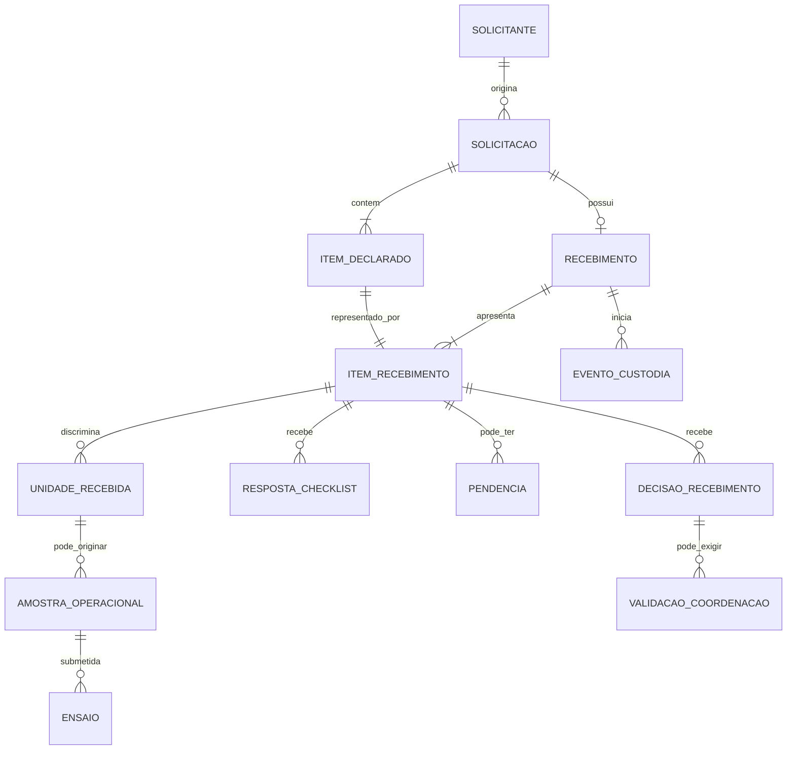

# Modelo Conceitual do Domínio — Solicitação e Recebimento

**Identificador:** MOD-DOM-001  
**Versão:** 0.1  
**Situação:** Proposta técnica para revisão funcional; não aprovada para implementação  
**Repositório:** keyzermoura/LIMS  
**Branch:** main  
**Data:** 2026-11-09

---

## 1. Objetivo e limites

Apresentar uma primeira estrutura conceitual para o domínio de solicitação, recebimento físico, conferência, custódia e criação da amostra operacional. O documento consolida as diretrizes já discutidas e explicita as lacunas que ainda precisam de decisão.

Este modelo não é um esquema físico de banco de dados. Nomes de entidades e relações são conceituais. Não autoriza criação de tabelas, migrações, endpoints, telas ou alterações no código.

## 2. Princípios que orientam o modelo

1. Solicitação e recebimento são registros distintos.
2. Uma solicitação pode conter vários itens declarados.
3. Cada solicitação possui no máximo um recebimento principal.
4. O recebimento apresenta todos os itens declarados, inclusive os não apresentados.
5. Quantidade declarada e quantidade efetivamente apresentada são informações distintas.
6. Não apresentado é situação de apresentação, não decisão técnica de recusa.
7. Conferência e decisão são independentes por item de recebimento.
8. A custódia começa na chegada física, antes da criação da amostra operacional.
9. A amostra operacional e seu identificador institucional só surgem após aceite final e validações obrigatórias.
10. A trilha histórica não pode ser reescrita para simular fatos ocorridos em data anterior.
11. Referências legadas permanecem opcionais quando não houver evidência confiável para associação.

## 3. Modelo conceitual proposto

### 3.1 Entidades e responsabilidades

| Entidade conceitual | Responsabilidade | Observações |
|---|---|---|
| Solicitante | Pessoa, órgão ou instituição que origina a demanda | Na primeira entrega, não terá conta externa no sistema. |
| Solicitação | Formalizar a demanda e identificar origem, finalidade e contexto | É cadastrada por usuário interno em nome do solicitante. |
| ItemDeclarado | Representar cada linha de material/produto declarada na solicitação | Guarda descrição, identificação declarada, quantidade e unidade de medida. |
| Recebimento | Registrar a única chegada física principal vinculada à solicitação | Guarda data/hora efetiva, recebedor físico e dados gerais da chegada. |
| ItemRecebimento | Registrar a apresentação, conferência e decisão relativa a cada ItemDeclarado | Deve existir também para item não apresentado. |
| UnidadeRecebida | Representar unidade física individual quando a rastreabilidade individual for necessária | A obrigatoriedade e a granularidade dependem da categoria de material e da decisão DEC05. |
| EventoCustodia | Registrar guarda, localização, responsável, transferência e condição do material | A origem inicial é o recebimento; a continuidade deve ser vinculada à amostra sem perder o histórico. |
| RespostaChecklist | Registrar a resposta a critério versionado de conferência | Inclui resultado, responsável, data/hora, justificativa e evidências. |
| Evidência | Referenciar documento, imagem ou arquivo que sustenta conferência ou decisão | Deve possuir metadados, autoria, integridade, controle de acesso e retenção. |
| Pendência | Registrar condição que impede conclusão até regularização | A regularização gera novo registro/histórico, não apaga a avaliação anterior. |
| DecisãoRecebimento | Registrar aceite, pendência ou recusa do item | Decisão formal individual, fundamentada e auditável. |
| ValidaçãoCoordenação | Registrar revisão da coordenação quando exigida | Não pode dispensar critérios impeditivos. |
| AmostraOperacional | Controlar o material admitido no ciclo laboratorial | Corresponde ao modelo atual DeviceSample, sujeito a compatibilização. |
| ReferênciaExterna | Associar identificador externo, como Harpya, quando aplicável | Opcional; não substitui o identificador institucional. |

### 3.2 Relações e cardinalidades propostas

| Origem | Relação | Destino | Regra |
|---|---:|---|---|
| Solicitante | 1:N | Solicitação | Um solicitante pode originar várias solicitações. |
| Solicitação | 1:N | ItemDeclarado | Uma solicitação possui um ou mais itens declarados. |
| Solicitação | 1:0..1 | Recebimento | No máximo um recebimento principal por solicitação. |
| Recebimento | 1:N | ItemRecebimento | O recebimento deve apresentar todas as linhas declaradas. |
| ItemDeclarado | 1:1 | ItemRecebimento | Cada linha declarada tem uma representação no recebimento, mesmo se não apresentada. |
| ItemRecebimento | 1:0..N | UnidadeRecebida | Unidades individuais são registradas quando a rastreabilidade por unidade for aplicável. |
| Recebimento | 1:N | EventoCustodia | A chegada inicia a custódia física do material apresentado. |
| ItemRecebimento ou UnidadeRecebida | 1:N | EventoCustodia | O nível exato do vínculo será definido por categoria e DEC04/DEC05. |
| ItemRecebimento | 1:N | RespostaChecklist | Uma conferência contém respostas aos critérios aplicáveis. |
| ItemRecebimento | 1:N | Pendência | Pode haver mais de uma pendência ou regularização histórica. |
| ItemRecebimento | 1:N | DecisãoRecebimento | Cada nova decisão deve ser preservada como evento histórico. |
| DecisãoRecebimento | 1:0..N | ValidaçãoCoordenação | Só ocorre quando a regra do fluxo exigir revisão. |
| UnidadeRecebida ou ItemRecebimento | 1:0..N | AmostraOperacional | A correspondência final depende da granularidade definida em DEC05; não presumir automaticamente uma amostra por linha declarada. |
| AmostraOperacional | 1:0..N | Ensaio | Uma amostra pode ser submetida a vários ensaios. |
| Solicitação ou ItemDeclarado ou AmostraOperacional | 1:0..N | ReferênciaExterna | O nível de associação depende da natureza do identificador externo. |

## 4. Diagrama lógico de referência

**Nota:** o diagrama é deliberadamente conceitual. A associação entre unidade recebida e amostra operacional ainda não está aprovada. Se o processo não exigir rastreabilidade individual da unidade, a relação poderá ocorrer diretamente entre ItemRecebimento e AmostraOperacional, desde que quantidade e identidade permaneçam inequívocas.

## 5. Separação dos estados

Não se deve condensar todos os estados em um único campo. Recomenda-se separar pelo menos as dimensões abaixo:

| Dimensão | Valores conceituais | Aplicação |
|---|---|---|
| Apresentação | Aguardando chegada; apresentado; não apresentado | Informa se o material declarado chegou fisicamente. |
| Conferência | Não iniciada; em andamento; concluída | Informa o progresso da verificação. |
| Resultado da conferência | Conforme; não conforme; não aplicável | Resultado por critério de checklist. |
| Situação de regularização | Sem pendência; pendente; em regularização; regularizada | Controla condições que precisam de providência. |
| Decisão do item | Não decidida; aceita; pendente; recusada | Resultado formal do recebimento por item. |
| Validação da coordenação | Não exigida; aguardando; aprovada; devolvida; rejeitada | Controla revisão quando aplicável. |
| Custódia | Sob guarda; transferida; encerrada | Controla responsabilidade e localização do material apresentado. |

Os valores definitivos, transições permitidas, eventos geradores e permissões devem ser especificados em uma máquina de estados própria antes da implementação.

## 6. Fluxo conceitual e sequência de eventos

1. Usuário interno cadastra a solicitação e seus itens declarados.
2. O sistema atribui identificador próprio à solicitação.
3. Na chegada, o recebedor registra data/hora efetiva, identidade e condições gerais.
4. O sistema cria o único recebimento principal e representa nele todas as linhas declaradas.
5. Para cada item, registra se foi apresentado ou não apresentado.
6. Para o material apresentado, inicia-se a custódia física imediatamente, com evento inicial, responsável e local.
7. O conferente realiza checklist, registra evidências e aponta pendências.
8. Cada item recebe decisão própria; pendências e regularizações preservam histórico.
9. Quando exigido, a coordenação revisa a decisão sem poder dispensar bloqueios impeditivos.
10. Somente após aceite final e validações obrigatórias o sistema cria a amostra operacional e seu identificador institucional.
11. A transferência da custódia para o ciclo da amostra mantém continuidade, autoria, horários e vínculo com o recebimento original.
12. Itens não apresentados permanecem registrados como não apresentados e não geram custódia nem amostra.

## 7. Recomendação para custódia pré-amostra

Recomenda-se tratar o recebimento como origem legítima dos primeiros eventos de custódia, sem criar antecipadamente uma AmostraOperacional. A arquitetura futura pode:

- manter um registro de eventos de custódia com referência polimórfica controlada à origem (recebimento/unidade recebida/amostra); ou
- criar eventos pré-aceite ligados a UnidadeRecebida e, no aceite, estabelecer vínculo explícito e auditável com a AmostraOperacional.

A segunda alternativa oferece integridade referencial mais forte se UnidadeRecebida for uma entidade persistente obrigatória. A primeira pode reduzir entidades, mas exige controles rigorosos para evitar referências órfãs e ambiguidades. A decisão deve considerar os padrões existentes de ChainOfCustody e as capacidades de integridade do PostgreSQL.

Em qualquer alternativa, o sistema deve preservar a data/hora real da chegada e o usuário que recebeu fisicamente o material. A data de criação posterior da amostra não pode substituir esses dados.

## 8. Regras de integridade essenciais

1. Restrição única de Recebimento por Solicitação, garantida no banco.
2. Um único ItemRecebimento correspondente a cada ItemDeclarado.
3. Itens não apresentados não podem possuir UnidadeRecebida nem AmostraOperacional.
4. Uma AmostraOperacional só pode ser criada após decisão final favorável e validações exigidas.
5. A criação da amostra e do identificador deve ser transacional e idempotente.
6. Uma unidade ou item não pode originar amostras duplicadas por reenvio ou concorrência.
7. Eventos de custódia, decisões, validações e respostas concluídas devem preservar histórico.
8. Correções devem registrar autor, data/hora, justificativa e valores anteriores/novos, conforme política aprovada.
9. Referências externas não são chaves primárias nem substituem o identificador institucional.
10. Registros legados sem vínculo confiável não devem receber associações inventadas.

## 9. Decisões ainda necessárias

| Decisão | Questão a resolver | Prioridade |
|---|---|---|
| DEC01 | Confirmar institucionalmente solicitação com múltiplos itens declarados. | P0 |
| DEC04 | Definir em que nível a custódia será registrada e como será transferida para a amostra. | P0 |
| DEC05 | Definir se cada linha declarada pode representar várias unidades físicas e quando cada unidade gera uma amostra operacional. | P0 |
| DEC07 | Confirmar se accession_number atual será formalizado como identificador institucional e como preservar QR Code. | P0 |
| DEC08 | Definir migração e convivência com amostras legadas sem vínculos de solicitação/recebimento. | P0 |
| DEC10 | Definir categorias de material e checklists versionados aplicáveis. | P1 |

## 10. Exemplos operacionais necessários para validar o modelo

Antes de fechar as cardinalidades físicas, validar pelo menos estes cenários reais:

1. Solicitação com um item declarado e uma unidade física apresentada.
2. Solicitação com um item declarado e várias unidades físicas do mesmo produto/lote.
3. Solicitação com vários itens declarados, parte apresentada e parte não apresentada.
4. Item declarado em quantidade 10, mas com quantidade física apresentada inferior ou superior.
5. Produto sem número de série individual, mas com lote identificável.
6. Material recebido em embalagem coletiva, com unidades internas não individualizadas no recebimento.
7. Um item aceito que, por regra técnica, exige mais de um corpo de prova.
8. Uma unidade física que será submetida a vários ensaios.

Esses cenários determinam se UnidadeRecebida será obrigatória para todos os materiais ou apenas para categorias que exigem rastreabilidade individual.

## 11. Critérios de revisão e aprovação

O modelo poderá ser considerado pronto para detalhamento físico quando:

- o responsável funcional confirmar os conceitos de item declarado, unidade física, amostra operacional e corpo de prova;
- DEC01, DEC04 e DEC05 tiverem decisão registrada;
- o fluxo de custódia pré-aceite e transferência para a amostra estiver definido;
- as cardinalidades e restrições de integridade estiverem coerentes com exemplos reais;
- a estratégia de convivência com dados legados estiver documentada;
- as regras de estados e transições tiverem responsáveis e permissões identificados.

## 12. Histórico de alterações

| Versão | Data | Descrição |
|---|---|---|
| 0.1 | 2026-11-09 | Primeira proposta conceitual de entidades, relações, estados e sequência de eventos. |
