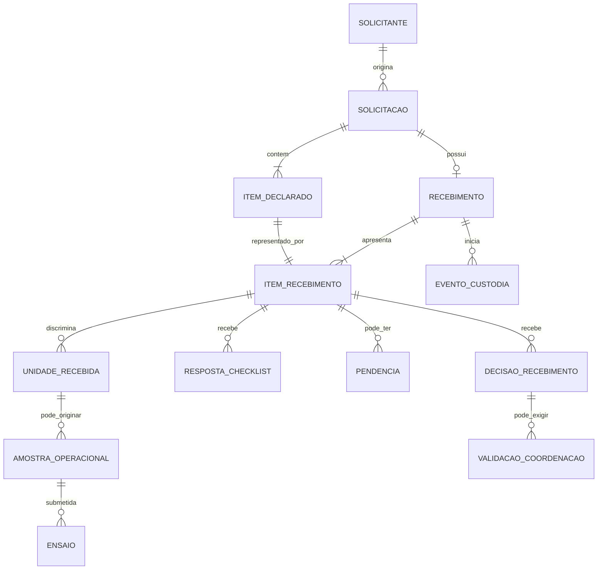

# Modelo Conceitual do Domínio — Solicitação e Recebimento

**Identificador:** MOD-DOM-001  
**Versão:** 0.4  
**Situação:** Modelo conceitual M0.2 aprovado funcionalmente, com consolidação 0.4 após auditoria EST01–EST10; não aprovado para implementação  
**Repositório:** keyzermoura/LIMS  
**Branch:** main  
**Data:** 2026-11-09

---

## 1. Objetivo e limites

Apresentar uma primeira estrutura conceitual para o domínio de solicitação, recebimento físico, conferência, custódia e criação da amostra operacional. O documento consolida as diretrizes já discutidas e explicita as lacunas que ainda precisam de decisão.

Este modelo não é um esquema físico de banco de dados. Nomes de entidades e relações são conceituais. Não autoriza criação de tabelas, migrações, endpoints, telas ou alterações no código.

## 2. Princípios que orientam o modelo

1. Solicitação e recebimento são registros distintos.
2. Uma solicitação pode conter vários itens declarados.
3. Cada solicitação possui no máximo um recebimento principal.
4. O recebimento apresenta todos os itens declarados, inclusive os não apresentados.
5. Quantidade declarada e quantidade efetivamente apresentada são informações distintas.
6. Não apresentado é situação de apresentação, não decisão técnica de recusa.
7. Conferência e decisão são independentes por item de recebimento.
8. A custódia começa na chegada física, antes da criação da amostra operacional.
9. A amostra operacional e seu identificador institucional só surgem após aceite final e validações obrigatórias.
10. A trilha histórica não pode ser reescrita para simular fatos ocorridos em data anterior.
11. Referências legadas permanecem opcionais quando não houver evidência confiável para associação.

## 3. Modelo conceitual proposto

### 3.1 Entidades e responsabilidades

| Entidade conceitual | Responsabilidade | Observações |
|---|---|---|
| Solicitante | Pessoa, órgão ou instituição que origina a demanda | Na primeira entrega, não terá conta externa no sistema. |
| Solicitação | Formalizar a demanda e identificar origem, finalidade e contexto | É cadastrada por usuário interno em nome do solicitante. |
| ItemDeclarado | Representar cada linha de material/produto declarada na solicitação | Guarda descrição, identificação declarada, quantidade e unidade de medida. |
| Recebimento | Registrar a única chegada física principal vinculada à solicitação | Guarda data/hora efetiva, recebedor físico e dados gerais da chegada. |
| ItemRecebimento | Registrar a apresentação, conferência e decisão relativa a cada ItemDeclarado | Deve existir também para item não apresentado. |
| UnidadeRecebida | Representar unidade física individual quando a rastreabilidade individual for necessária | A obrigatoriedade e a granularidade dependem da categoria de material e da decisão DEC05. |
| EventoCustodia | Registrar guarda, localização, responsável, transferência e condição do material | A origem inicial é o recebimento; a continuidade deve ser vinculada à amostra sem perder o histórico. |
| RespostaChecklist | Registrar a resposta a critério versionado de conferência | Inclui resultado, responsável, data/hora, justificativa e evidências. |
| Evidência | Referenciar documento, imagem ou arquivo que sustenta conferência ou decisão | Deve possuir metadados, autoria, integridade, controle de acesso e retenção. |
| Pendência | Registrar condição que impede conclusão até regularização | A regularização gera novo registro/histórico, não apaga a avaliação anterior. |
| DecisãoRecebimento | Registrar aceite, pendência ou recusa do item | Decisão formal individual, fundamentada e auditável. |
| ValidaçãoCoordenação | Registrar revisão da coordenação quando exigida | Não pode dispensar critérios impeditivos. |
| AmostraOperacional | Controlar o material admitido no ciclo laboratorial | Corresponde ao modelo atual DeviceSample, sujeito a compatibilização. |
| ReferênciaExterna | Associar identificador externo, como Harpya, quando aplicável | Opcional; não substitui o identificador institucional. |

### 3.2 Relações e cardinalidades propostas

| Origem | Relação | Destino | Regra |
|---|---:|---|---|
| Solicitante | 1:N | Solicitação | Um solicitante pode originar várias solicitações. |
| Solicitação | 1:N | ItemDeclarado | Uma solicitação possui um ou mais itens declarados. |
| Solicitação | 1:0..1 | Recebimento | No máximo um recebimento principal por solicitação. |
| Recebimento | 1:N | ItemRecebimento | O recebimento deve apresentar todas as linhas declaradas. |
| ItemDeclarado | 1:1 | ItemRecebimento | Cada linha declarada tem uma representação no recebimento, mesmo se não apresentada. |
| ItemRecebimento | 1:0..N | UnidadeRecebida | Unidades individuais são registradas quando a rastreabilidade por unidade for aplicável. |
| Recebimento | 1:N | EventoCustodia | A chegada inicia a custódia física do material apresentado. |
| ItemRecebimento ou UnidadeRecebida | 1:N | EventoCustodia | O nível exato do vínculo será definido por categoria e DEC04/DEC05. |
| ItemRecebimento | 1:N | RespostaChecklist | Uma conferência contém respostas aos critérios aplicáveis. |
| ItemRecebimento | 1:N | Pendência | Pode haver mais de uma pendência ou regularização histórica. |
| ItemRecebimento | 1:N | DecisãoRecebimento | Cada nova decisão deve ser preservada como evento histórico. |
| DecisãoRecebimento | 1:0..N | ValidaçãoCoordenação | Só ocorre quando a regra do fluxo exigir revisão. |
| UnidadeRecebida ou ItemRecebimento | 1:0..N | AmostraOperacional | A correspondência final depende da granularidade definida em DEC05; não presumir automaticamente uma amostra por linha declarada. |
| AmostraOperacional | 1:0..N | Ensaio | Uma amostra pode ser submetida a vários ensaios. |
| Solicitação ou ItemDeclarado ou AmostraOperacional | 1:0..N | ReferênciaExterna | O nível de associação depende da natureza do identificador externo. |

## 4. Diagrama lógico de referência

**Nota:** o diagrama é deliberadamente conceitual. A associação entre unidade recebida e amostra operacional ainda não está aprovada. Se o processo não exigir rastreabilidade individual da unidade, a relação poderá ocorrer diretamente entre ItemRecebimento e AmostraOperacional, desde que quantidade e identidade permaneçam inequívocas.

## 5. Separação dos estados

Não se deve condensar todos os estados em um único campo. Recomenda-se separar pelo menos as dimensões abaixo:

| Dimensão | Valores conceituais | Aplicação |
|---|---|---|
| Apresentação | Aguardando chegada; apresentado; não apresentado | Informa se o material declarado chegou fisicamente. |
| Conferência | Não iniciada; em andamento; concluída | Informa o progresso da verificação. |
| Resultado da conferência | Conforme; não conforme; não aplicável | Resultado por critério de checklist. |
| Situação de regularização | Sem pendência; pendente; em regularização; regularizada | Controla condições que precisam de providência. |
| Decisão do item | Não decidida; aceita; pendente; recusada | Resultado formal do recebimento por item. |
| Validação da coordenação | Não exigida; aguardando; aprovada; devolvida; rejeitada | Controla revisão quando aplicável. |
| Custódia | Sob guarda; transferida; encerrada | Controla responsabilidade e localização do material apresentado. |

Os valores definitivos, transições permitidas, eventos geradores e permissões devem ser especificados em uma máquina de estados própria antes da implementação.

## 6. Fluxo conceitual e sequência de eventos

1. Usuário interno cadastra a solicitação e seus itens declarados.
2. O sistema atribui identificador próprio à solicitação.
3. Na chegada, o recebedor registra data/hora efetiva, identidade e condições gerais.
4. O sistema cria o único recebimento principal e representa nele todas as linhas declaradas.
5. Para cada item, registra se foi apresentado ou não apresentado.
6. Para o material apresentado, inicia-se a custódia física imediatamente, com evento inicial, responsável e local.
7. O conferente realiza checklist, registra evidências e aponta pendências.
8. Cada item recebe decisão própria; pendências e regularizações preservam histórico.
9. Quando exigido, a coordenação revisa a decisão sem poder dispensar bloqueios impeditivos.
10. Somente após aceite final e validações obrigatórias o sistema cria a amostra operacional e seu identificador institucional.
11. A transferência da custódia para o ciclo da amostra mantém continuidade, autoria, horários e vínculo com o recebimento original.
12. Itens não apresentados permanecem registrados como não apresentados e não geram custódia nem amostra.

## 7. Recomendação para custódia pré-amostra

Recomenda-se tratar o recebimento como origem legítima dos primeiros eventos de custódia, sem criar antecipadamente uma AmostraOperacional. A arquitetura futura pode:

- manter um registro de eventos de custódia com referência polimórfica controlada à origem (recebimento/unidade recebida/amostra); ou
- criar eventos pré-aceite ligados a UnidadeRecebida e, no aceite, estabelecer vínculo explícito e auditável com a AmostraOperacional.

A segunda alternativa oferece integridade referencial mais forte se UnidadeRecebida for uma entidade persistente obrigatória. A primeira pode reduzir entidades, mas exige controles rigorosos para evitar referências órfãs e ambiguidades. A decisão deve considerar os padrões existentes de ChainOfCustody e as capacidades de integridade do PostgreSQL.

Em qualquer alternativa, o sistema deve preservar a data/hora real da chegada e o usuário que recebeu fisicamente o material. A data de criação posterior da amostra não pode substituir esses dados.

## 8. Regras de integridade essenciais

1. Restrição única de Recebimento por Solicitação, garantida no banco.
2. Um único ItemRecebimento correspondente a cada ItemDeclarado.
3. Itens não apresentados não podem possuir UnidadeRecebida nem AmostraOperacional.
4. Uma AmostraOperacional só pode ser criada após decisão final favorável e validações exigidas.
5. A criação da amostra e do identificador deve ser transacional e idempotente.
6. Uma unidade ou item não pode originar amostras duplicadas por reenvio ou concorrência.
7. Eventos de custódia, decisões, validações e respostas concluídas devem preservar histórico.
8. Correções devem registrar autor, data/hora, justificativa e valores anteriores/novos, conforme política aprovada.
9. Referências externas não são chaves primárias nem substituem o identificador institucional.
10. Registros legados sem vínculo confiável não devem receber associações inventadas.

## 9. Decisões ainda necessárias

| Decisão | Questão a resolver | Prioridade |
|---|---|---|
| DEC01 | Confirmar institucionalmente solicitação com múltiplos itens declarados. | P0 |
| DEC04 | Definir em que nível a custódia será registrada e como será transferida para a amostra. | P0 |
| DEC05 | Definir se cada linha declarada pode representar várias unidades físicas e quando cada unidade gera uma amostra operacional. | P0 |
| DEC07 | Confirmar se accession_number atual será formalizado como identificador institucional e como preservar QR Code. | P0 |
| DEC08 | Definir migração e convivência com amostras legadas sem vínculos de solicitação/recebimento. | P0 |
| DEC10 | Definir categorias de material e checklists versionados aplicáveis. | P1 |

## 10. Exemplos operacionais necessários para validar o modelo

Antes de fechar as cardinalidades físicas, validar pelo menos estes cenários reais:

1. Solicitação com um item declarado e uma unidade física apresentada.
2. Solicitação com um item declarado e várias unidades físicas do mesmo produto/lote.
3. Solicitação com vários itens declarados, parte apresentada e parte não apresentada.
4. Item declarado em quantidade 10, mas com quantidade física apresentada inferior ou superior.
5. Produto sem número de série individual, mas com lote identificável.
6. Material recebido em embalagem coletiva, com unidades internas não individualizadas no recebimento.
7. Um item aceito que, por regra técnica, exige mais de um corpo de prova.
8. Uma unidade física que será submetida a vários ensaios.

Esses cenários determinam se UnidadeRecebida será obrigatória para todos os materiais ou apenas para categorias que exigem rastreabilidade individual.

## 11. Critérios de revisão e aprovação

O modelo poderá ser considerado pronto para detalhamento físico quando:

- o responsável funcional confirmar os conceitos de item declarado, unidade física, amostra operacional e corpo de prova;
- DEC01, DEC04 e DEC05 tiverem decisão registrada;
- o fluxo de custódia pré-aceite e transferência para a amostra estiver definido;
- as cardinalidades e restrições de integridade estiverem coerentes com exemplos reais;
- a estratégia de convivência com dados legados estiver documentada;
- as regras de estados e transições tiverem responsáveis e permissões identificados.

## 12. Recomendações técnicas para DEC04 e DEC05

As recomendações abaixo refinam o modelo, mas permanecem sujeitas à validação funcional e institucional.

### 12.1 Objeto de custódia

Recomenda-se introduzir a entidade conceitual **ObjetoCustodia**, vinculada ao ItemRecebimento, para representar o material que efetivamente permanece sob guarda institucional. O objeto pode representar:
- uma unidade física individual, quando houver identificação/rastreabilidade individual;
- um agrupamento homogêneo de unidades, quando a avaliação e a guarda forem realizadas como conjunto e o procedimento técnico permitir.

Os eventos de custódia devem referenciar o ObjetoCustodia, e não diretamente a AmostraOperacional, pois a custódia começa antes da criação da amostra. Quando a amostra for criada, deve ser estabelecido vínculo explícito entre a amostra e o objeto de origem. A transferência para a custódia laboratorial será um evento novo, preservando o histórico anterior.

Recomenda-se evitar uma referência polimórfica sem integridade referencial. A estrutura física definitiva depende da revisão do schema e da decisão sobre agrupamento.

### 12.2 Regra de granularidade

A recomendação é não impor equivalência automática entre ItemDeclarado, unidade física, ObjetoCustodia, AmostraOperacional e corpo de prova.

- ItemDeclarado descreve o que foi solicitado.
- ItemRecebimento registra o que foi apresentado e conferido.
- ObjetoCustodia representa a unidade de guarda/rastreabilidade, individual ou agrupada.
- AmostraOperacional representa o registro laboratorial admitido após aceite.
- Corpo de prova é definido pelo método/plano de ensaio.

Criar uma amostra operacional por objeto aceito que necessite de decisão, rastreabilidade ou resultado independente. Quando várias unidades homogêneas forem avaliadas como um único conjunto, permitir agrupamento explícito, com quantidade, lote e identificação preservados. Quando houver resultados ou destinos independentes, separar os registros.

### 12.3 Cenários que devem ser validados

| Cenário | Representação recomendada para discussão |
|---|---|
| Dez agulhas do mesmo lote avaliadas como conjunto | Um ObjetoCustodia agrupado e uma AmostraOperacional do conjunto, se o procedimento permitir. |
| Três seringas serializadas com avaliação individual | Três objetos de rastreabilidade e, em princípio, três AmostrasOperacionais. |
| Um equipo submetido a vários ensaios | Uma AmostraOperacional pode originar vários corpos de prova/execuções. |
| Dez unidades declaradas, cinco apresentadas | Quantidade declarada 10, apresentada 5; cinco ausentes ficam NAO_APRESENTADO e não geram custódia/amostra. |
| Embalagem coletiva sem identificação individual interna | ObjetoCustodia pode representar a embalagem/conjunto, com quantidade e lote; individualização conforme procedimento técnico. |

Os exemplos não são decisões finais sobre critérios de amostragem. Devem ser confirmados com casos reais anonimizados e responsáveis técnicos do laboratório.

### 12.4 Regras de segurança conceitual

1. Não exigir número de série individual em todas as categorias sem requisito técnico.
2. Não usar fabricante + lote como identificador universal de unidade.
3. Não criar AmostraOperacional para item não apresentado, pendente ou recusado.
4. Não criar um registro por corpo de prova quando o conceito adequado for uma execução vinculada à amostra, salvo requisito do método.
5. Não encerrar custódia de material recusado antes da devolução/destinação efetivamente registrada.
6. Preservar chegada física, recebedor real e eventos de custódia anteriores à criação da amostra.

## 13. Histórico de alterações

| Versão | Data | Descrição |
|---|---|---|
| 0.1 | 2026-11-09 | Primeira proposta conceitual de entidades, relações, estados e sequência de eventos. |
| 0.2 | 2026-11-09 | Inclusão das recomendações de ObjetoCustodia, granularidade e cenários para DEC04/DEC05. |

## 14. Registro formal da decisão M0.2

**Decisão:** APROVADA INTEGRALMENTE  
**Data da aprovação:** 2026-11-10  
**Responsável pela validação funcional:** usuário responsável pelo projeto LIMS  
**Escopo da aprovação:** modelo conceitual do domínio e cardinalidades recomendadas, incluindo a entidade ObjetoCustodia, a separação entre item declarado, item de recebimento, objeto de custódia, amostra operacional e corpo de prova, e a regra de granularidade descrita na seção 12.

### 14.1 Cardinalidades aprovadas

| Relação | Cardinalidade aprovada | Regra |
|---|---:|---|
| Solicitante → Solicitação | 1:N | Um solicitante pode originar várias solicitações. |
| Solicitação → ItemDeclarado | 1:N | Uma solicitação contém um ou mais itens declarados. |
| Solicitação → Recebimento | 1:0..1 | No máximo um recebimento principal por solicitação. |
| ItemDeclarado → ItemRecebimento | 1:1 | Toda linha declarada é representada no recebimento, inclusive quando não apresentada. |
| ItemRecebimento → ObjetoCustodia | 1:0..N | Cada objeto representa unidade individual ou agrupamento homogêneo justificado. |
| ObjetoCustodia → AmostraOperacional | 1:0..1 | Um objeto aceito pode originar no máximo uma amostra operacional. |
| AmostraOperacional → Ensaio | 1:N | Uma amostra pode originar vários ensaios. |

### 14.2 Decisões consolidadas

1. A custódia começa na chegada física, antes do aceite e da criação da amostra operacional.
2. ObjetoCustodia é a referência conceitual para guarda e rastreabilidade pré-amostra.
3. Não será criada entidade independente UnidadeFisica na primeira versão; ObjetoCustodia poderá representar unidade individual ou agrupamento homogêneo tecnicamente justificado.
4. A criação da amostra operacional depende de aceite final e das validações obrigatórias.
5. Material recusado permanece sob custódia até devolução ou destinação formal efetivamente registrada.
6. Itens não apresentados não geram objeto de custódia nem amostra operacional.
7. A quantidade de amostras não será presumida a partir da quantidade declarada ou recebida; dependerá da rastreabilidade, da independência das decisões e do plano de ensaio.
8. A decisão por objeto de custódia deve ser rastreável individualmente; o estado do item de recebimento será consolidado a partir dos objetos associados, quando houver mais de um.

### 14.3 Efeito da aprovação

A aprovação encerra a revisão funcional do modelo conceitual M0.2 e autoriza o detalhamento das regras de estados e transições. **Não autoriza implementação**, alterações de schema, migrações, endpoints, frontend ou infraestrutura. Essas atividades permanecem condicionadas à conclusão e aprovação dos gates correspondentes.

### 14.4 Histórico

| Versão | Data | Descrição |
|---|---|---|
| 0.3 | 2026-11-10 | Registro da aprovação integral do modelo de domínio M0.2 e consolidação das cardinalidades e decisões funcionais. |

## 15. Consolidação de domínio após auditoria EST01–EST10

**Data:** 2026-11-10  
**Versão do modelo:** 0.4  
**Situação:** consolidação funcional do modelo M0.2; não aprovada para implementação.

Esta seção torna explícitas as decisões aprovadas na seção 14 e elimina ambiguidades de nomenclatura presentes nas seções preliminares. Não altera as cardinalidades aprovadas em M0.2.

### 15.1 Entidades canônicas e responsabilidades

| Entidade | Responsabilidade consolidada | Observação |
|---|---|---|
| Solicitante | Pessoa, órgão ou instituição em nome de quem a demanda é registrada. | Não implica conta externa na primeira entrega. |
| Solicitação | Demanda administrativa e seu contexto. | Possui no máximo um recebimento principal. |
| ItemDeclarado | Linha de material solicitada. | Preserva quantidade e unidade declaradas. |
| Recebimento | Registro da chegada física principal. | Guarda data/hora efetivas e recebedor real. |
| ItemRecebimento | Representação de cada ItemDeclarado no recebimento. | Existe também para itens não apresentados. |
| ObjetoCustodia | Material efetivamente apresentado e mantido sob custódia, individual ou agrupado de forma tecnicamente justificada. | Entidade canônica para custódia e decisão independente quando aplicável. |
| EventoCustodia | Evento imutável de início, movimentação, transferência ou encerramento da custódia. | Não é substituto do ObjetoCustodia; registra fatos e transições. |
| RespostaChecklist | Resultado de critério de checklist versionado. | Preserva versão, avaliador, data/hora, justificativa e evidências. |
| Pendência | Providência requerida e seu ciclo de comunicação, regularização, prazo e encerramento. | Pode estar vinculada ao item ou objeto afetado. |
| DecisãoRecebimento | Ato formal de aceite, pendência ou recusa. | Registrada no ObjetoCustodia quando desfechos puderem divergir; no ItemRecebimento quando o desfecho for único. |
| ValidaçãoCoordenação | Revisão de decisão específica quando obrigatória. | Deve ser independente do autor/executor nos casos aplicáveis. |
| Evidência | Documento, imagem ou arquivo que sustenta fato, conferência ou decisão. | Integridade, autoria, acesso e retenção a especificar. |
| AmostraOperacional | Registro laboratorial criado após aceite final. | Cada ObjetoCustodia pode originar no máximo uma amostra. |
| Ensaio | Atividade analítica vinculada à amostra. | Uma amostra pode originar vários ensaios. |
| ReferênciaExterna | Identificador de sistema externo quando aplicável. | Não substitui identificador institucional. |

**Nomenclatura:** UnidadeRecebida deixa de ser entidade canônica da primeira versão. A necessidade de representar uma unidade individual é atendida por ObjetoCustodia, que também pode representar agrupamento homogêneo justificado. Não criar UnidadeFisica independente na primeira versão, conforme M0.2.

### 15.2 Cardinalidades canônicas aprovadas

| Origem | Cardinalidade | Destino | Regra |
|---|---:|---|---|
| Solicitante | 1:N | Solicitação | Um solicitante pode originar várias solicitações. |
| Solicitação | 1:N | ItemDeclarado | Uma solicitação possui um ou mais itens declarados. |
| Solicitação | 1:0..1 | Recebimento | No máximo um recebimento principal por solicitação. |
| ItemDeclarado | 1:1 | ItemRecebimento | Cada linha declarada possui uma representação no recebimento. |
| ItemRecebimento | 1:0..N | ObjetoCustodia | Somente material apresentado pode gerar objeto(s). |
| ObjetoCustodia | 1:0..1 | AmostraOperacional | No máximo uma amostra operacional por objeto aceito. |
| AmostraOperacional | 1:N | Ensaio | Uma amostra pode originar vários ensaios. |

EventoCustodia deve referenciar ObjetoCustodia; Pendência, RespostaChecklist e DecisãoRecebimento devem referenciar o menor nível funcionalmente adequado (item ou objeto), preservando integridade e rastreabilidade. Essas referências não alteram as cardinalidades aprovadas acima.

### 15.3 Regras de decisão e consolidação

1. A decisão é registrada no ObjetoCustodia quando houver possibilidade de aceite, recusa, resultado, rastreabilidade ou destinação independentes.
2. A decisão diretamente no ItemRecebimento somente se aplica quando o desfecho for único para todo o material e não houver discriminação necessária.
3. Quando um ItemRecebimento possuir vários ObjetosCustodia, sua situação é derivada das decisões dos objetos.
4. Decisões divergentes devem ser visíveis como situação agregada PARCIALMENTE_DECIDIDO ou equivalente; nunca ocultar o detalhe por objeto.
5. Um objeto recusado não implica recusa dos demais objetos do item.
6. O item só pode ser integralmente aceito quando todos os objetos apresentados estiverem aceitos e as validações obrigatórias concluídas.
7. Itens não apresentados não geram ObjetoCustodia, decisão técnica ou AmostraOperacional.

### 15.4 Custódia e continuidade laboratorial

1. A custódia começa na chegada física e antes do aceite/amostra.
2. O estado atual de custódia é uma projeção do último evento válido e confirmado; eventos anteriores permanecem preservados.
3. Transferência solicitada, mas não confirmada pelo destinatário, não transfere a responsabilidade.
4. A custódia só é encerrada após devolução/entrega ou destinação autorizada efetivamente realizada e documentada.
5. A criação da AmostraOperacional não reinicia a custódia. A passagem à guarda laboratorial gera novo evento de transferência/continuidade, vinculado ao ObjetoCustodia.
6. Objeto recusado permanece sob custódia até destinação efetiva.

### 15.5 Criação da AmostraOperacional

A criação exige decisão ACEITA no nível aplicável, checklist concluído, ausência de pendências impeditivas abertas e validações obrigatórias concluídas. A operação deve ser atômica e idempotente, protegida contra reenvio/concorrência, e preservar vínculo com ObjetoCustodia e Recebimento. A cardinalidade 1:0..1 impede duplicação de amostra por objeto.

AmostraOperacional não é sinônimo de unidade física nem de corpo de prova. A definição e quantidade de corpos de prova decorrem do método/plano de ensaio, fora do escopo decisório de recebimento.

### 15.6 Identidade, permissões, validação e assinatura

Os cinco perfis funcionais aprovados são SOLICITANTE, RECEPÇÃO, CONFERENTE, COORDENAÇÃO e ADMINISTRADOR. Permissões são explícitas e verificadas no momento da operação; perfis podem ser acumulados quando autorizados, respeitada a independência obrigatória da EST10. ADMINISTRADOR não possui autoridade técnica implícita nem pode elevar as próprias permissões ou apagar auditoria.

Assinatura eletrônica formal e validação independente são controles distintos. A assinatura formal vincula usuário, ato e conteúdo exato; a validação independente exige ator diferente do autor/executor quando prevista. A tecnologia e o nível jurídico da assinatura permanecem para especificação própria.

### 15.7 Pendências, retificações e dados legados

1. Pendências usam os estados PENDENTE, EM_REGULARIZACAO, AGUARDANDO_REAVALIACAO, REGULARIZADA, PRAZO_VENCIDO, NAO_REGULARIZAVEL e CANCELADA. PRAZO_VENCIDO não encerra a pendência nem gera recusa automática; NAO_REGULARIZAVEL exige decisão formal e não equivale automaticamente à recusa.
2. Retificações são novos atos vinculados ao original, sem sobrescrita; exigem justificativa, evidência, validação da coordenação quando aplicável, assinatura formal e avaliação de impacto quando já houver amostra.
3. Registros legados sem evidência confiável não devem receber vínculo presumido com Solicitação, Recebimento, ItemRecebimento ou ObjetoCustodia.
4. Identificadores externos permanecem referências auxiliares e não substituem o identificador institucional.

### 15.8 Prevalência e histórico

Esta seção 15 consolida a interpretação atual do modelo aprovado em M0.2. Se houver divergência entre recomendações preliminares das seções 1–13 e as decisões formais da seção 14 ou esta consolidação, prevalecem as cardinalidades e decisões aprovadas em 14.1–14.3 e as regras consolidadas nesta seção 15. O histórico original é preservado para rastreabilidade.

| Versão | Data | Descrição |
|---|---|---|
| 0.4 | 2026-11-10 | Consolidação do domínio após auditoria EST01–EST10; padronização de ObjetoCustodia, granularidade decisória, custódia, amostra, perfis e pendências, sem alteração das cardinalidades M0.2. |
