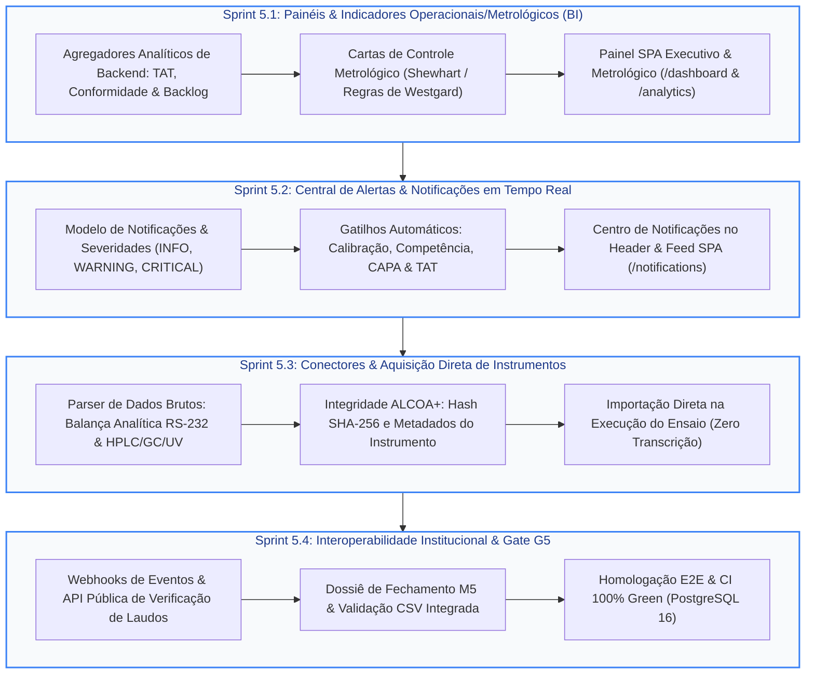

# Plano Diretor de Execução — Fase 5: Módulos Avançados, Integrações e Expansão (Marco M5 / Gate G5)

**Sistema LIMS — Fiscalização & Laboratório SEFI / FUNED**  
**Data:** 16 de Novembro de 2026  
**Branch de Trabalho:** `feature/fase-5-integracoes-expansao` (a partir de `main`)  
**Base Normativa:** ISO/IEC 17025:2017 (§7.11, §8.8), 21 CFR Part 11, ALCOA+ Data Integrity e GAMP 5 Categoria 4/5  

---

## 1. Visão Geral e Alinhamento Estratégico

Com as **Fases 1 a 4 homologadas em produção e 100% integradas na branch `main`**, o LIMS consolidou com excelência regulatória:
1. O fluxo de ingresso, conferência física e custódia legal de amostras (Fase 1);
2. A gestão metrológica de equipamentos, métodos e rastreabilidade de dados brutos (Fase 2);
3. O fluxo de revisão técnica por pares, segregação de funções e laudos periciais com assinatura digital ICP-Brasil e QR Code (Fase 3);
4. O motor de incerteza de medição GUM, regras de decisão ILAC-G8, matriz de competência de analistas, ciclo completo de CAPA e dossiê formal CSV GAMP 5 (Fase 4).

A **Fase 5 (Marco M5 / Gate G5)** conclui a visão holística do **Plano Diretor do Projeto LIMS**, elevando o sistema ao patamar de plataforma laboratorial analítica conectada, proativa e orientada a dados:
- **Operação orientada a dados (BI & Analytics):** Dashboards em tempo real com tempos de ciclo (Turnaround Time - TAT), indicadores de conformidade, produtividade e cartas de controle metrológico de Shewhart/Westgard;
- **Proatividade e prevenção de falhas:** Motor de alertas e notificações em tempo real que antecipa vencimentos de calibração, qualificações expiradas e gargalos de amostras;
- **Eliminação de transcrição manual (Zero Transcription Errors):** Conectores de aquisição direta de dados de instrumentos analíticos (balanças analíticas, espectrofotômetros e cromatógrafos) preservando a integridade ALCOA+ e hash SHA-256 dos dados brutos originais;
- **Interoperabilidade Institucional:** Barramento de integração com SEFI/FUNED, webhooks de eventos laboratoriais e verificação pública segura de autenticidade de laudos.

---

## 2. Estrutura de Decomposição do Trabalho (Sprints da Fase 5)

---

## 3. Detalhamento dos Sprints da Fase 5

### 🔹 Sprint 5.1: Painéis Gerenciais, Indicadores Operacionais e Metrológicos (BI)
- **Objetivo:** Fornecer à coordenação do laboratório e à direção institucional visibilidade contínua e fidedigna sobre desempenho operacional, produtividade e controle estatístico de processos (ISO 17025 §8.8 e §7.7).
- **Entregáveis de Backend:**
  - Rota `GET /api/v1/analytics/operational`:
    - Métricas de Turnaround Time (TAT) global e por fase (recebimento $\rightarrow$ ensaio $\rightarrow$ revisão $\rightarrow$ laudo);
    - Amostras em aberto estratificadas por faixa etária (0–5 dias, 6–15 dias, >15 dias);
    - Taxa de conformidade de resultados por método e família de produtos;
    - Carga de trabalho por analista e equipamento.
  - Rota `GET /api/v1/analytics/quality-control`:
    - Dados para Cartas de Controle de Shewhart / Levey-Jennings: média ($\mu$), desvio-padrão ($\sigma$), limites de controle ($\pm 2\sigma$ alerta, $\pm 3\sigma$ ação);
    - Indicador de estabilidade metrológica e taxa de reanálise de ensaios.
- **Entregáveis de Frontend:**
  - Telas SPA completas e responsivas com visualização gráfica interativa:
    - Cards de KPIs executivos com gradientes profissionais;
    - Gráficos de barras e linhas para distribuição de TAT e volume de amostras;
    - Visualizador interativo de Cartas de Controle com demarcação clara das regras de Westgard.

---

### 🔹 Sprint 5.2: Central de Notificações e Alertas em Tempo Real
- **Objetivo:** Antecipar desvios metrológicos, não conformidades e estouro de prazos antes que afetem a integridade das amostras ou laudos.
- **Modelagem de Dados:**
  - Tabela `notifications`:
    - `id` (UUID), `user_id` (opcional para notificações direcionadas), `target_role` (opcional para broadcast de perfil: `ROLE_TECNICO`, `ROLE_GERENTE`), `title`, `message`, `severity` (`INFO`, `WARNING`, `CRITICAL`), `category` (`CALIBRATION`, `COMPETENCE`, `CAPA`, `TAT`, `SAMPLE_ISSUE`), `link_url`, `is_read`, `created_at`.
- **Gatilhos em Tempo Real & Serviços de Verificação:**
  - Alerta de equipamento com calibração a expirar em $\le 15$ dias ou já vencida;
  - Alerta de analista executando ensaio com qualificação vencida ou inexistente;
  - Alerta de CAPA com verificação de eficácia pendente ou ação 5W2H atrasada;
  - Alerta de ensaio reprovado ou com incerteza na zona de indecisão ILAC-G8.
- **Interface SPA:**
  - Componente `NotificationBell` dinâmico na Topbar com contagem de notificações não lidas;
  - Menu flutuante interativo de notificações recentes com marcação de leitura e navegação imediata ao item afetado;
  - Página completa `/notifications` com filtros de severidade e busca.

---

### 🔹 Sprint 5.3: Conectores e Aquisição Direta de Instrumentos Analíticos (LIMS Data Acquisition)
- **Objetivo:** Eliminar erros humanos de transcrição e digitação manual em resultados críticos (ISO 17025 §7.11 e 21 CFR Part 11).
- **Mecanismos de Conexão e Ingestão:**
  - **Balanças Analíticas:** Ingestão de relatórios de pesagem RS-232 / CSV contendo tara, peso bruto, peso líquido e identificação da balança;
  - **Espectrofotômetros UV-Vis / Cromatógrafos:** Ingestão de arquivos de dados brutos (CSV, TXT, JSON) contendo comprimentos de onda, absorbâncias, áreas de pico e concentrações calculadas.
- **Rastreabilidade e ALCOA+:**
  - Armazenamento imutável do arquivo bruto original com cálculo de hash SHA-256 no momento da ingestão;
  - Preenchimento automatizado das medições da execução de ensaio (`TestExecution`) vinculado à assinatura eletrônica do operador.
- **Interface de Usuário:**
  - Módulo visual de upload/dropzone e parsing automático com pré-visualização tabular dos dados brutos antes da confirmação do analista.

---

### 🔹 Sprint 5.4: Interoperabilidade Institucional, Webhooks e Gate G5
- **Objetivo:** Estabelecer a integração segura entre o LIMS e sistemas externos institucionais (SEFI / FUNED), viabilizando comunicação contínua e conferência pública de autenticidade documental.
- **Entregáveis:**
  - API pública de validação de autenticidade de laudos periciais (`/api/v1/public/reports/verify/{token_or_hash}`) com retorno de status de integridade, emitente e data sem expor dados restritos de investigações policiais;
  - Motor de Webhooks para notificação de eventos externos a outros sistemas da SEFI;
  - Dossiê final de encerramento do Marco M5 e aprovação formal no Portão Gate G5;
  - Atualização do preview visual interativo do ecossistema LIMS (`LIMS_PREVIEW_FASE1_A_FASE5.html`).

---

## 4. Critérios de Aceite e Homologação (Portão Gate G5)

Para aprovação formal e encerramento do Marco M5 / Portão G5, os seguintes critérios são mandatários:
1. **Pipeline CI 100% Verde:** Todos os 3 jobs do GitHub Actions (`Backend Tests & Lint`, `Frontend Build & Test` e `Docker Compose Build`) passando sem falhas nem avisos;
2. **Zero Regressão:** 100% das suítes de testes de regressão das Fases 1 a 4 executando com sucesso no PostgreSQL 16;
3. **Novas Suítes de Testes:** Cobertura de testes de integração para agregadores de BI, alertas em tempo real, conectores de instrumentos e validação de laudos;
4. **Paridade Rigorosa Alembic:** Execução de `alembic check` atestando sincronização absoluta de schemas, enums e tipos no PostgreSQL;
5. **Auditoria e Conformidade ALCOA+:** Nenhum dado de instrumento importado sem hash SHA-256 e trilha de auditoria completa.
